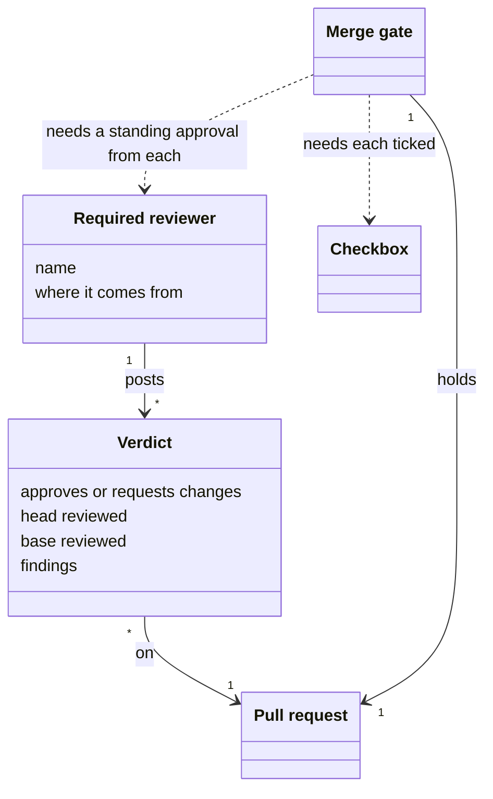
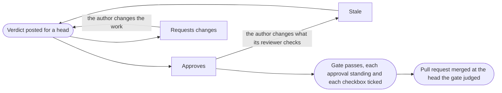

# VIEW-reviews-and-the-merge — Reviews and the merge

In the `agent` review mode, no person is assigned to review, so an agent's review needs a signal that counts as approval. The signal must say whose review it is, what stops self-approval, and when it goes stale (DEC-028).

A [verdict](../glossary.md#term-verdict--verdict) is that signal. A [required reviewer](../glossary.md#term-required-reviewer--required-reviewer) is an agent whose verdict the [change](../../core/glossary.md#term-change--change) needs. The [merge gate](../glossary.md#term-merge-gate--merge-gate) holds the [pull request](../../core/glossary.md#term-pull-request--pull-request) to their verdicts before it lands.

## Verdict

Defined in [TERM-verdict](../glossary.md#term-verdict--verdict).

**Why:** In the `agent` review mode, no person is assigned to review, so an agent's review needs a signal that counts as approval. A command must read the signal, tell whose it is, and see when new commits make it stale (DEC-028).

A verdict is a comment a [reviewer](../../core/glossary.md#term-reviewer--reviewer) agent posts on a [pull request](../../core/glossary.md#term-pull-request--pull-request). Its first line approves the [change](../../core/glossary.md#term-change--change) or requests changes, and a marker names the [head](../../core/glossary.md#term-head--head) and the [base](../../core/glossary.md#term-base--base) it reviewed. Its [findings](../../core/glossary.md#term-finding--finding) follow, each tagged for what it does to the merge.

**Attributes:**

- its first line, `APPROVED` or `CHANGES_REQUESTED`, with the reviewer's name (DEC-028)
- its marker, which names the head and the base it reviewed (DEC-028)
- its findings, each tagged `[block]`, `[person]` or `[advisory]` (DEC-028)

**Relations:**

- A reviewer agent posts it on one pull request (DEC-028).
- The [merge gate](../glossary.md#term-merge-gate--merge-gate) reads each [required reviewer](../glossary.md#term-required-reviewer--required-reviewer)'s latest verdict (DEC-028 and DEC-032 point D3).

**States:** A verdict approves the change or requests changes. An approval stands until the author changes something its reviewer checks, and is then stale. A verdict whose base the pull request no longer stands on is stale too (DEC-028).

**Always true:**

- Only a comment that carries the marker counts as a verdict (DEC-028).
- A verdict that is missing or cannot be read never satisfies the merge gate (DEC-028).
- Each `[person]` finding is shown whole to whoever authorises the merge (DEC-028 and DEC-055 point 3).

## Required reviewer

Defined in [TERM-required-reviewer](../glossary.md#term-required-reviewer--required-reviewer).

**Why:** A [change](../../core/glossary.md#term-change--change) may carry a concern beyond the [project](../../core/glossary.md#term-project--project)'s own review, such as its design, which another [capability](../../core/glossary.md#term-capability--capability)'s [reviewer](../../core/glossary.md#term-reviewer--reviewer) checks. That capability contributes its reviewer, so project-management never names a discipline most projects never install. Every declared concern is then checked, and none is dropped silently (DEC-032).

A required reviewer is an agent whose approving [verdict](../glossary.md#term-verdict--verdict) a [pull request](../../core/glossary.md#term-pull-request--pull-request) needs before it merges. The project names some in its settings. Installed capabilities contribute others, for changes whose classification or content meets a condition.

**Attributes:**

- its name, as the project registers it (DEC-028)
- where it comes from: the project's settings, or a capability's contribution with its condition (DEC-032 points D1 and D2)

**Relations:**

- It posts verdicts on the pull requests that need it (DEC-028).
- A change needs a contributed reviewer where the change meets the reviewer's condition, such as `touches-code` (DEC-032 point D1).

**States:** None.

**Always true:**

- Every required reviewer must approve, and none stands in for another (DEC-032 point D3).
- Where the set of required reviewers cannot be worked out, no command goes on with part of it (DEC-032 point D5).
- A project declines a contributed reviewer only with its reason, in its settings (DEC-032 point D2).

## Merge gate

Defined in [TERM-merge-gate](../glossary.md#term-merge-gate--merge-gate).

**Why:** An approval counts only for what its [reviewer](../../core/glossary.md#term-reviewer--reviewer) saw. So the gate judges one [head](../../core/glossary.md#term-head--head), and the merge is pinned to it. A push between the two then fails the merge, rather than landing commits no [verdict](../glossary.md#term-verdict--verdict) covers (DEC-028). A [Task](../glossary.md#term-task--task)'s [checkboxes](../glossary.md#term-checkbox--checkbox) are checked before the merge, since closing the Task by the merge would otherwise pass them by (DEC-007).

The merge gate is the set of conditions project-management holds a [pull request](../../core/glossary.md#term-pull-request--pull-request) to before it lands it. Each [required reviewer](../glossary.md#term-required-reviewer--required-reviewer)'s latest verdict must be a standing approval, its checks must be green, and the checkboxes of each [issue](../glossary.md#term-issue--issue) it closes ticked.

**Attributes:** None.

**Relations:**

- It reads each required reviewer's latest verdict (DEC-028).
- It reads the checkboxes of each issue the pull request closes (DEC-007).
- It judges one head of the pull request (DEC-028).

**States:** None.

**Always true:**

- The merge is pinned to the head the gate judged (DEC-028).
- A gate that passes gives no [authorisation](../glossary.md#term-authorisation--authorisation) to merge, which stays the person's (DEC-055 point 3).
- A person sets aside one required reviewer's approval only with a reason, which a comment records (DEC-050).
