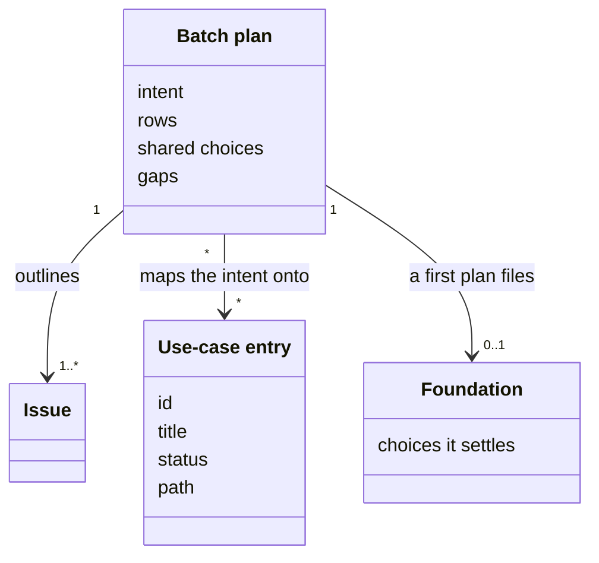
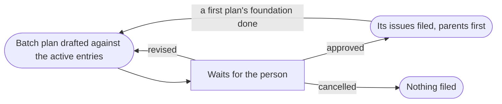

# VIEW-batch-planning — Batch planning

An intent becomes many issues, and slicing it well needs the [project](../../core/glossary.md#term-project--project)'s own account of what its software must do. That account is another [component](../../core/glossary.md#term-component--component)'s, so it comes through a [data point](../../core/glossary.md#term-data-point--data-point). Slicing is a judgement, so a person approves the whole batch plan before anything is filed ([DEC-029](../../../../.pkit/capabilities/project-management/decisions/DEC-029-project-manager-agent-shape.md) and [DEC-054](../../../../.pkit/capabilities/project-management/decisions/DEC-054-use-case-validation.md)).

A [use-case entry](../glossary.md#term-use-case-entry--use-case-entry) names one goal of that account. A [batch plan](../glossary.md#term-batch-plan--batch-plan) is the outline the agent drafts against the entries. The person approves it, revises it or cancels it.

Where the slices would share a choice that nothing settles yet, a first plan files only the work's foundation. A second plan files the slices once the foundation is done ([DEC-060](../../../../.pkit/capabilities/project-management/decisions/DEC-060-foundation-before-slices.md)).

## Use-case entry

Defined in [TERM-use-case-entry](../glossary.md#term-use-case-entry--use-case-entry).

**Why:** [Components](../../core/glossary.md#term-component--component) exchange what they know through [data points](../../core/glossary.md#term-data-point--data-point), without depending on each other. So project-management reads the [project](../../core/glossary.md#term-project--project)'s account of its software through one, never through another component's files. Whatever keeps that account, or the project itself, fills the data point ([DEC-054](../../../../.pkit/capabilities/project-management/decisions/DEC-054-use-case-validation.md)).

A use-case entry is one item of that data point. It names one goal the project's software serves, by its id and its title, and says whether it is active or withdrawn. Where it can, it also gives the path of the document that describes the goal.

**Attributes:**

- its id, `UC-` and three digits or more, in the form the data point's version 1 gives ([DEC-054 point 1](../../../../.pkit/capabilities/project-management/decisions/DEC-054-use-case-validation.md#1-the-point))
- its title (DEC-054 point 1)
- its status, `active` or `withdrawn` (DEC-054 point 1)
- the path of its document, where the filler gives one (DEC-054 point 1)

**Relations:**

- One component fills the data point, and a file of the project's own replaces what that component gives, whole (DEC-054 point 1).
- A [Feature](../glossary.md#term-feature--feature)'s or a [Task](../glossary.md#term-task--task)'s body may cite it in a `## Use cases` section ([DEC-054 point 4](../../../../.pkit/capabilities/project-management/decisions/DEC-054-use-case-validation.md#4-the-rule)).

**States:** An entry is active or withdrawn (DEC-054 point 1).

**Always true:**

- The data point holds the entries settled on the [default branch](../../core/glossary.md#term-default-branch--default-branch) (DEC-054 point 1).
- An id names one entry for good, so a citation of a withdrawn one stays true (DEC-054).

## Batch plan

Defined in [TERM-batch-plan](../glossary.md#term-batch-plan--batch-plan).

**Why:** An intent becomes many issues, and slicing it is a judgement a person must check. One approval of the whole batch plan keeps the agent's speed without filing work nobody agreed to. Adversarial review before that approval catches bad slicing where it costs least ([DEC-029](../../../../.pkit/capabilities/project-management/decisions/DEC-029-project-manager-agent-shape.md)).

A batch plan is the outline the project-manager agent drafts for an intent. It holds the issues for that intent, each with its parent, classification and [use-case entries](../glossary.md#term-use-case-entry--use-case-entry). The person approves it, revises it or cancels it, and nothing is filed before they approve it.

**Attributes:**

- one row for each issue: its type, title, parent, [workstream](../glossary.md#term-workstream--workstream), [Milestone](../glossary.md#term-milestone--milestone), priority and use-case entries (DEC-029 and [DEC-054 point 5](../../../../.pkit/capabilities/project-management/decisions/DEC-054-use-case-validation.md#5-the-planning-step))
- the active entries the intent touches that no issue names, and the work that no entry describes (DEC-054 point 5)
- each choice the slices would share, judged settled, in hand by an open foundation, or open ([DEC-060 point 3](../../../../.pkit/capabilities/project-management/decisions/DEC-060-foundation-before-slices.md#3-the-first-plan-files-the-foundation-and-the-second-plans-the-slices))
- the [findings](../../core/glossary.md#term-finding--finding) of the [reviewers](../../core/glossary.md#term-reviewer--reviewer) run on it (DEC-029)

**Relations:**

- It outlines the issues for one intent, parents before children (DEC-029).
- It maps the intent onto the active use-case entries (DEC-054 point 5).
- A first plan files the EPIC, with an outline of the slices, and the [Feature](../glossary.md#term-feature--feature) of the work's foundation. A second plan files the slices under that EPIC, once the foundation's Feature has closed (DEC-060 point 3).

**States:** A batch plan is drafted, then waits for the person. Approved, its issues are filed, parents first. Revised, it is drafted again, and cancelled, nothing is filed (DEC-029). A first plan's slices wait for a second plan, drafted once the foundation's Feature closes (DEC-060 point 3).

**Always true:**

- None of its issues is filed before the person approves the whole plan (DEC-029).
- It cites only ids the [data point](../../core/glossary.md#term-data-point--data-point) holds, and never suggests one (DEC-054 point 5).
- A first plan files no slice (DEC-060 point 3).

## Foundation

Defined in [TERM-foundation](../glossary.md#term-foundation--foundation).

**Why:** A choice that each Task makes alone is made again for each Task, and the results do not fit together. Merging them costs more than deciding once. So the choices the slices would share are settled first, and each slice rests on records and code that exist (DEC-060).

A foundation is the first part of new work whose slices would share a choice that nothing settles yet. It is filed as one Feature, whose body lists the choices it settles.

Its Tasks are built one at a time. The first holds a record of each architectural choice, which a person accepts. One thin slice, built end to end on those records, then settles the choices of convention.

**Attributes:**

- the choices it settles, which its Feature's body lists (DEC-060 point 2)
- its Tasks, each naming the one before among its dependencies (DEC-060 point 2)

**Relations:**

- A first batch plan files its Feature under the work's EPIC, and no slice (DEC-060 point 3).
- A second batch plan slices the work, once its Feature has closed (DEC-060 point 3).
- A Task not yet started that would make one of its choices waits, naming its Feature among that Task's dependencies (DEC-060 point 4).

**States:** A foundation is open until its Feature closes, which a person authorises. It is then done (DEC-060 point 3).

**Always true:**

- A choice that an open foundation settles is in hand, so new work plans no foundation of its own for that choice (DEC-060 point 1).
- A foundation that proves wrong is changed through a Task of its own, and never worked around (DEC-060 point 5).
- Where one agent builds all the work in order, a person may fold its thin slice into the work's first slice (DEC-060 point 2).

## What is built on these concepts

Each concept below lists the use cases, journeys and requirements whose text links its term.

**Use-case entry:**

- [UC-060 — File a Task under its parent, its title and body checked as it is filed](../use-case-model/use-cases/020-file-and-move/UC-060-file-task.md)
- [UC-063 — Plan an intent into an EPIC and its work, filed once I approve the plan](../use-case-model/use-cases/010-plan/UC-063-plan-intent.md)

**Batch plan:**

- [UC-063 — Plan an intent into an EPIC and its work, filed once I approve the plan](../use-case-model/use-cases/010-plan/UC-063-plan-intent.md)
