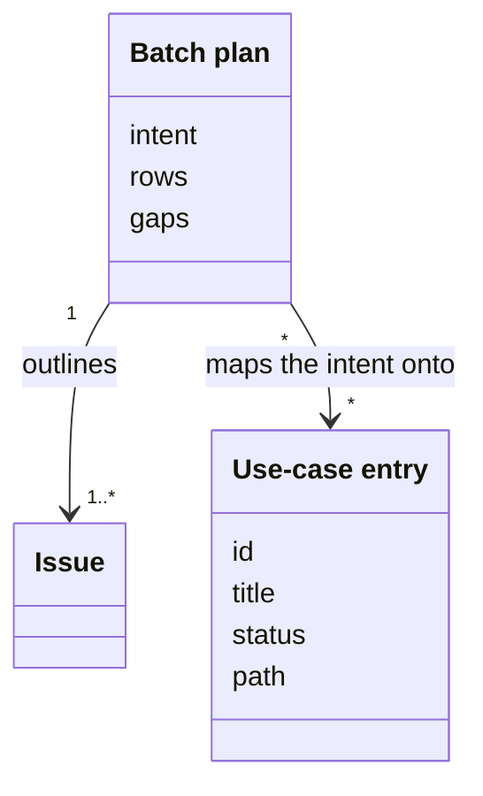
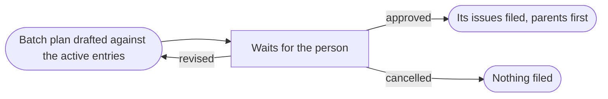

# VIEW-batch-planning — Batch planning

A planner's intent becomes many issues, and slicing it well needs the [project](../../core/glossary.md#term-project--project)'s own account of what its software must do. That account is another [component](../../core/glossary.md#term-component--component)'s, so it comes through a [data point](../../core/glossary.md#term-data-point--data-point). Slicing is a judgement, so a person approves the whole outline before anything is filed (DEC-029 and DEC-054).

A [use-case entry](../glossary.md#term-use-case-entry--use-case-entry) names one goal of that account. A [batch plan](../glossary.md#term-batch-plan--batch-plan) is the outline the agent drafts against the entries, which the person approves, revises or cancels.

## Use-case entry

Defined in [TERM-use-case-entry](../glossary.md#term-use-case-entry--use-case-entry).

**Why:** [Components](../../core/glossary.md#term-component--component) exchange what they know through [data points](../../core/glossary.md#term-data-point--data-point), without depending on each other. So project-management reads the [project](../../core/glossary.md#term-project--project)'s account of its software through one, never through another component's files. Whatever keeps that account, or the project itself, answers for it (DEC-054).

A use-case entry is one item of that data point. It names one goal the project's software serves, by its id and its title, and says whether it is active or withdrawn. Where it can, it also gives the path of the document that describes the goal.

**Attributes:**

- its id, `UC-` and three digits or more, at version 1 (DEC-054 point 1)
- its title (DEC-054 point 1)
- its status, `active` or `withdrawn` (DEC-054 point 1)
- the path of its document, where the filler gives one (DEC-054 point 1)

**Relations:**

- One component fills the data point, and a file of the project's own replaces that [answer](../../core/glossary.md#term-answer--answer) whole (DEC-054 point 1).
- A [Feature](../glossary.md#term-feature--feature)'s or a [Task](../glossary.md#term-task--task)'s body may cite it in a `## Use cases` section (DEC-054 point 4).

**States:** An entry is active or withdrawn (DEC-054 point 1).

**Always true:**

- The data point holds the entries settled on the [default branch](../../core/glossary.md#term-default-branch--default-branch) (DEC-054 point 1).
- An id names one entry for good, so a citation of a withdrawn one stays true (DEC-054).

## Batch plan

Defined in [TERM-batch-plan](../glossary.md#term-batch-plan--batch-plan).

**Why:** A planner's intent becomes many issues, and slicing it is a judgement a person must check. One approval of the whole outline keeps the agent's speed without filing work nobody agreed to. Adversarial review before that approval catches bad slicing where it costs least (DEC-029).

A batch plan is the outline the project-manager agent drafts for an intent. It holds an [EPIC](../glossary.md#term-epic--epic) and its work, each [issue](../glossary.md#term-issue--issue) with its parent, classification and [use-case entries](../glossary.md#term-use-case-entry--use-case-entry). The person approves it, revises it or cancels it, and nothing is filed before they approve it.

**Attributes:**

- one row for each issue: its type, title, parent, [workstream](../glossary.md#term-workstream--workstream), [Milestone](../glossary.md#term-milestone--milestone), priority and use-case entries (DEC-029 and DEC-054 point 5)
- the active entries the intent touches that no issue names, and the work that no entry describes (DEC-054 point 5)
- the [findings](../../core/glossary.md#term-finding--finding) of the [reviewers](../../core/glossary.md#term-reviewer--reviewer) run on it (DEC-029)

**Relations:**

- It outlines the issues for one intent, parents before children (DEC-029).
- It maps the intent onto the active use-case entries (DEC-054 point 5).

**States:** A batch plan is drafted, then waits for the person. Approved, its issues are filed, parents first. Revised, it is drafted again, and cancelled, nothing is filed (DEC-029).

**Always true:**

- None of its issues is filed before the person approves the whole plan (DEC-029).
- It cites only ids the [data point](../../core/glossary.md#term-data-point--data-point) holds, and never suggests one (DEC-054 point 5).
