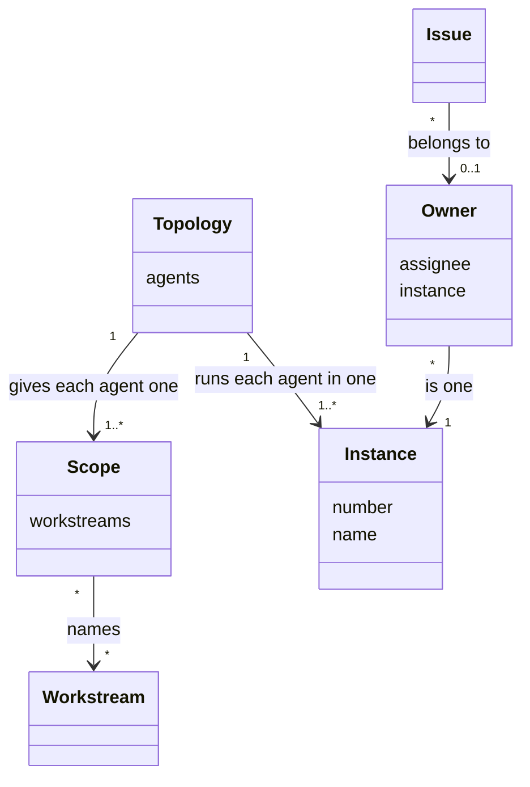

# VIEW-parallel-work — Parallel work

Several AI agents may work on one [project](../../core/glossary.md#term-project--project) at the same time, each in a clone of its own and often under one person's account. Each must know its own job, and no two may work on one [issue](../glossary.md#term-issue--issue). A [topology](../glossary.md#term-topology--topology) names the agents and gives each a [scope](../glossary.md#term-scope--scope). Each agent works in an [instance](../glossary.md#term-instance--instance), and the [owner](../glossary.md#term-owner--owner) of an issue says which instance works on it (DEC-035 and DEC-045).

These concepts serve the use cases of the area [040-work-in-parallel](../overview/README.md#040-work-in-parallel), and the journey [JRN-004](../use-case-model/journeys/JRN-004-direct-parallel-work.md) tells that area's story from start to end.

## Topology

Defined in [TERM-topology](../glossary.md#term-topology--topology).

**Why:** Agents that work at the same time each have a distinct job. Each needs to know its own name and job, and work needs to reach the agent whose job it is (DEC-045).

A topology is the set of AI agents a [project](../../core/glossary.md#term-project--project) runs on its work at the same time. It names each agent and gives it a [scope](../glossary.md#term-scope--scope). It also says whether each agent plans, builds or does both.

**Attributes:**

- each agent's name (DEC-045 point 1)
- each agent's scope (DEC-045 point 3)
- whether each agent plans, builds or does both (the <!-- pkit:not-the-term -->roles #512 names)

**Relations:**

- It gives each of its agents one scope (DEC-045 point 3).
- Each of its agents works in one [instance](../glossary.md#term-instance--instance) (DEC-035 point 1).

**States:** None.

**Always true:**

- A topology names [workstreams](../glossary.md#term-workstream--workstream), and never changes one (DEC-045 point 3).

## Scope

Defined in [TERM-scope](../glossary.md#term-scope--scope).

**Why:** Work must reach the agent whose job it is. A [project](../../core/glossary.md#term-project--project) already divides its work into long-lived areas, so a scope names those areas rather than adding another way to divide the work (DEC-045).

A scope is the part of a project's work that one agent of a [topology](../glossary.md#term-topology--topology) takes its issues from. The accepted records give it as a set of [workstreams](../glossary.md#term-workstream--workstream). A scope by stage of the work, such as design or testing, has no form yet.

**Attributes:**

- the workstreams it names (DEC-045 point 3)

**Relations:**

- It names workstreams, and changes none of them (DEC-045 point 3).
- Two agents' scopes may name one workstream, and a workstream may lie in no scope (DEC-045 point 4).

**States:** None.

**Always true:**

- A workstream that two scopes name, or that no scope names, is allowed and warned of (DEC-045 point 4).

## Instance

Defined in [TERM-instance](../glossary.md#term-instance--instance).

**Why:** One person's clones all act under one GitHub account. Without a mark of their own, no clone can tell which work in flight is its own, and the clones step on each other (DEC-035).

An instance is a clone of a [project](../../core/glossary.md#term-project--project)'s repository that has set a number of its own. Sessions start and end in it, and the number stays. A clone that sets none works as clones did before instances existed.

**Attributes:**

- its number, one of a pool of four for each person (DEC-035 points 1 and 2)
- its name, such as `data` (DEC-045 point 1)

**Relations:**

- An agent of a [topology](../glossary.md#term-topology--topology) works in one instance (DEC-035 point 1).
- An instance may be the [owner](../glossary.md#term-owner--owner) of issues (DEC-035 point 3).

**States:** A clone becomes an instance once it sets a number, and stops being one when the number is cleared (DEC-035 point 1).

**Always true:**

- The number lives only in its clone, and is never committed (DEC-035 point 1).
- An instance is never an input to a move of the [issue lifecycle](../glossary.md#term-issue-lifecycle--issue-lifecycle) (DEC-035 point 8).

## Owner

Defined in [TERM-owner](../glossary.md#term-owner--owner).

**Why:** Each clone must see which work is another's, and be kept from acting on it. GitHub offers no atomic claim, so the owner lets a clash be caught and resolved, though not prevented (DEC-035).

The owner of an [issue](../glossary.md#term-issue--issue) is the [instance](../glossary.md#term-instance--instance) it belongs to, from its filing or its start until its close, paired with the issue's assignee. The same person's other instances see the issue as another's, and leave it alone. Different people's instances never mix, since each person's numbers are their own.

**Attributes:**

- the assignee and the instance's number (DEC-035 point 2)
- where it is written: a label, or a log of comments on the issue with a summary in its description (DEC-043 points 2 to 4)

**Relations:**

- An issue has at most one owner once a clash is resolved (DEC-035 point 6).
- An instance that files work owns all of it, the parents and the Tasks under them (DEC-035 point 3).

**States:** An issue has no owner until an instance files it or starts it. A hand-over moves the owner to another instance. A close, or a new assignee, clears it (DEC-035 points 3 to 5).

**Always true:**

- Two instances that take one issue at the same instant end with one owner, the lower number (DEC-035 point 6).
- The owner is never an input to a gate, a move of the [issue lifecycle](../glossary.md#term-issue-lifecycle--issue-lifecycle) or the [cascade](../glossary.md#term-cascade--cascade) (DEC-035 point 8 and DEC-043 point 6).
- In the comment log, the comments are the record, and the summary in the description is rebuilt from them (DEC-043 points 3 and 4).
