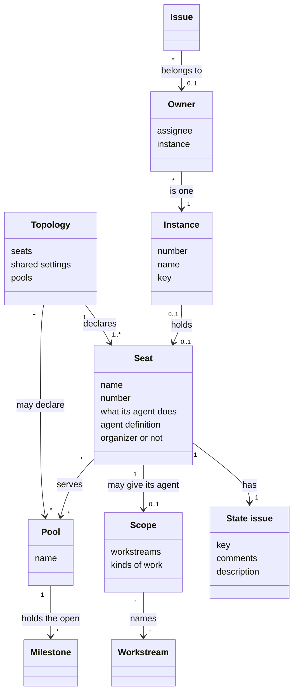
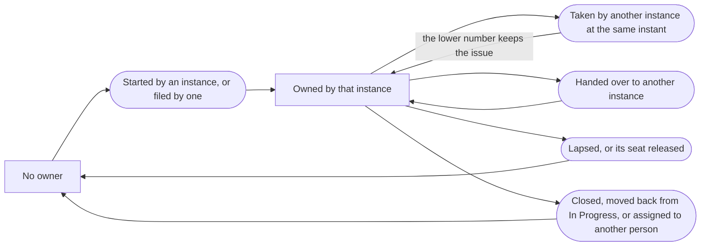
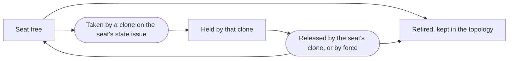

# VIEW-parallel-work — Parallel work

Several AI agents may work on one [project](../../core/glossary.md#term-project--project) at the same time, each agent in a separate clone and often under one person's account. Each agent must know the agent's own job, and no two agents may work on one [issue](../glossary.md#term-issue--issue). A [topology](../glossary.md#term-topology--topology) declares a [seat](../glossary.md#term-seat--seat) for each job, and a seat may give the seat's agent a [scope](../glossary.md#term-scope--scope). Each agent works in an [instance](../glossary.md#term-instance--instance), and the [owner](../glossary.md#term-owner--owner) of an issue says which instance works on the issue ([DEC-035](../../../../.pkit/capabilities/project-management/decisions/DEC-035-instance-ownership.md) and [DEC-059](../../../../.pkit/capabilities/project-management/decisions/DEC-059-topology-of-seats.md)).

Each seat has a [state issue](../glossary.md#term-state-issue--state-issue), which shows which clone holds the seat now ([DEC-058](../../../../.pkit/capabilities/project-management/decisions/DEC-058-state-issues.md) and [DEC-059 point 3](../../../../.pkit/capabilities/project-management/decisions/DEC-059-topology-of-seats.md#3-each-seat-has-a-state-issue-which-the-topology-names)).

A topology may also declare [pools](../glossary.md#term-pool--pool) of workers. Each seat that builds then takes its work only from the pools it serves. A person puts each line of work into a pool by its [Milestone](../glossary.md#term-milestone--milestone) ([DEC-061](../../../../.pkit/capabilities/project-management/decisions/DEC-061-pools-of-workers.md)).

These concepts serve the use cases in [040-work-in-parallel](../overview/README.md#040-work-in-parallel). The journey [JRN-004](../use-case-model/journeys/JRN-004-set-up-and-adjust-topology.md) follows the adopter across those use cases, from setting up the topology to adjusting the topology on what the adopter measures.

## Topology

Defined in [TERM-topology](../glossary.md#term-topology--topology).

**Why:** Every clone, on one machine or on a platform's sandboxes, must read the same [seats](../glossary.md#term-seat--seat). The planning agent must see what each seat covers ([DEC-059](../../../../.pkit/capabilities/project-management/decisions/DEC-059-topology-of-seats.md)).

A topology is the set of seats a [project](../../core/glossary.md#term-project--project) declares for the AI agents that work on the project at the same time. The topology is the project's committed configuration, which every clone reads from the [default branch](../../core/glossary.md#term-default-branch--default-branch) ([DEC-059 point 1](../../../../.pkit/capabilities/project-management/decisions/DEC-059-topology-of-seats.md#1-the-topology-is-committed-configuration-read-from-the-default-branch)). A [change](../../core/glossary.md#term-change--change) to the topology binds once the change merges.

**Attributes:**

- its seats, in a list where each seat keeps its place (DEC-059 points [2](../../../../.pkit/capabilities/project-management/decisions/DEC-059-topology-of-seats.md#2-a-seat-has-a-name-a-role-an-agent-and-an-optional-scope) and [6](../../../../.pkit/capabilities/project-management/decisions/DEC-059-topology-of-seats.md#6-a-clones-identity-is-its-seats-name-and-its-number-comes-from-the-topology))
- the settings its seats share, such as the mode in which a seat is released (DEC-059 point 2)
- the [pools](../glossary.md#term-pool--pool) of workers it declares, where it declares any ([DEC-061 point 1](../../../../.pkit/capabilities/project-management/decisions/DEC-061-pools-of-workers.md#1-the-topology-declares-pools-and-each-seat-that-builds-names-those-it-serves))

**Relations:**

- It declares one seat or more (DEC-059 point 2).
- It may declare pools, which the seats that build serve (DEC-061 point 1).

**States:** None.

**Always true:**

- A topology names [workstreams](../glossary.md#term-workstream--workstream), and never changes a workstream ([DEC-045 point 3](../../../../.pkit/capabilities/project-management/decisions/DEC-045-named-per-user-instances.md#3-instances-reference-workstreams-1many-they-never-rebind-the-taxonomy)).
- Seats are only added at the end of the topology's list, and a seat that leaves stays in the list, marked retired (DEC-059 point 6).
- A topology never says which clone holds a seat ([DEC-058 point 1](../../../../.pkit/capabilities/project-management/decisions/DEC-058-state-issues.md#1-what-a-person-reviews-is-configuration-and-what-changes-at-run-time-is-a-state-issue)).
- Code that cannot read the topology in full uses none of the authority the topology grants. Such code takes no work, no seat and no release by force ([DEC-061 point 9](../../../../.pkit/capabilities/project-management/decisions/DEC-061-pools-of-workers.md#9-code-that-cannot-read-the-topology-in-full-uses-none-of-the-authority-it-grants)).

## Seat

Defined in [TERM-seat](../glossary.md#term-seat--seat).

**Why:** Each clone runs with a job of its own, and the other clones must see which jobs are held. Which seats exist, and what each does, is what a person decides and reviews ([DEC-059](../../../../.pkit/capabilities/project-management/decisions/DEC-059-topology-of-seats.md)).

A seat is one place in a [topology](../glossary.md#term-topology--topology), and one clone holds the seat at a time. The seat says whether the clone's agent plans, builds or does both, and which [agent definition](../../core/glossary.md#term-agent-definition--agent-definition) that agent follows. A clone takes a seat, and the clone's agent then acts as the seat says (DEC-059 points [2](../../../../.pkit/capabilities/project-management/decisions/DEC-059-topology-of-seats.md#2-a-seat-has-a-name-a-role-an-agent-and-an-optional-scope) and [4](../../../../.pkit/capabilities/project-management/decisions/DEC-059-topology-of-seats.md#4-a-clone-takes-a-seat-by-its-name-or-the-first-free-seat)).

**Attributes:**

- its name, which never changes and becomes the identity of the clone that holds the seat (DEC-059 points 2 and [6](../../../../.pkit/capabilities/project-management/decisions/DEC-059-topology-of-seats.md#6-a-clones-identity-is-its-seats-name-and-its-number-comes-from-the-topology), and [DEC-045 point 1](../../../../.pkit/capabilities/project-management/decisions/DEC-045-named-per-user-instances.md#1-instances-gain-a-human-readable-name))
- its number, its place in the topology's list, counted from one (DEC-059 point 6)
- whether its agent plans, builds or does both, as the planning agent, a worker agent or a lead agent (DEC-059 point 2)
- the agent definition its agent follows, the project-manager agent's by default (DEC-059 points 2 and [8](../../../../.pkit/capabilities/project-management/decisions/DEC-059-topology-of-seats.md#8-the-agent-a-seat-names-runs-the-seats-role-through-the-pm-skill))
- a [scope](../glossary.md#term-scope--scope), which is optional (DEC-059 point 2)
- the [pools](../glossary.md#term-pool--pool) it serves, where it builds and the topology declares pools ([DEC-061 point 1](../../../../.pkit/capabilities/project-management/decisions/DEC-061-pools-of-workers.md#1-the-topology-declares-pools-and-each-seat-that-builds-names-those-it-serves))
- the number of its [state issue](../glossary.md#term-state-issue--state-issue) ([DEC-059 point 3](../../../../.pkit/capabilities/project-management/decisions/DEC-059-topology-of-seats.md#3-each-seat-has-a-state-issue-which-the-topology-names))
- whether it is the organizer seat, whose clone may release other seats by force (DEC-059 point 2)

**Relations:**

- A topology declares the seat (DEC-059 point 2).
- At most one clone holds the seat at a time, and a clone holds at most one seat (DEC-059 point 4).
- The seat has one state issue, which logs each clone that takes the seat or releases the seat (DEC-059 point 3).

**States:** A seat is free until a clone takes the seat, and is held until that clone releases the seat. In the first and most tolerant mode, nothing else frees the seat but a release by force, which the seat's state issue logs. A retired seat stays in the list. A clone that holds a retired seat releases the seat at the clone's next command (DEC-059 points [5](../../../../.pkit/capabilities/project-management/decisions/DEC-059-topology-of-seats.md#5-in-the-first-mode-a-seat-stays-taken-until-it-is-released) and 6).

**Always true:**

- A seat keeps its name and its number for as long as the topology lists the seat (DEC-059 points 2 and 6).

## Scope

Defined in [TERM-scope](../glossary.md#term-scope--scope).

**Why:** Some [seats](../glossary.md#term-seat--seat) do one kind of work only, such as testing. A scope narrows the work such a seat's agent takes, and reserves nothing for that seat ([DEC-059](../../../../.pkit/capabilities/project-management/decisions/DEC-059-topology-of-seats.md)).

A scope is the part of a [project](../../core/glossary.md#term-project--project)'s work that one agent of a [topology](../glossary.md#term-topology--topology) takes issues from. A scope names [workstreams](../glossary.md#term-workstream--workstream), kinds of work such as `test` or `docs`, or both ([DEC-059 point 7](../../../../.pkit/capabilities/project-management/decisions/DEC-059-topology-of-seats.md#7-work-reaches-agents-through-one-shared-pool)). A [Task](../glossary.md#term-task--task) falls in a scope where the Task matches each part the scope names. A seat with no scope takes from all the project's ready Tasks, or from all those of its [pools](../glossary.md#term-pool--pool) where the topology declares pools.

**Attributes:**

- the workstreams it names ([DEC-045 point 3](../../../../.pkit/capabilities/project-management/decisions/DEC-045-named-per-user-instances.md#3-instances-reference-workstreams-1many-they-never-rebind-the-taxonomy))
- the kinds of work it names (DEC-059 point 7)

**Relations:**

- A seat may give the seat's agent a scope ([DEC-059 point 2](../../../../.pkit/capabilities/project-management/decisions/DEC-059-topology-of-seats.md#2-a-seat-has-a-name-a-role-an-agent-and-an-optional-scope)).
- A scope names workstreams and kinds of work, and changes no workstream and no kind of work (DEC-045 point 3 and DEC-059 point 7).

**States:** None.

**Always true:**

- A scope reserves nothing for its seat, so the other seats keep all the ready Tasks (DEC-059 point 7).
- Where the topology declares pools, a scope narrows what its seat's pools hold ([DEC-061 point 1](../../../../.pkit/capabilities/project-management/decisions/DEC-061-pools-of-workers.md#1-the-topology-declares-pools-and-each-seat-that-builds-names-those-it-serves)).
- A workstream that no seat may take is warned of, and never blocked. Several seats that may take one workstream draw no warning (DEC-059 point 7).

## Pool

Defined in [TERM-pool](../glossary.md#term-pool--pool).

**Why:** A person decides what each worker may take, and how many workers each line of work gets. Lines of work start and finish often, so a line of work changes no committed configuration ([DEC-061](../../../../.pkit/capabilities/project-management/decisions/DEC-061-pools-of-workers.md)).

A pool is a named set of a [project](../../core/glossary.md#term-project--project)'s open [Milestones](../glossary.md#term-milestone--milestone), whose work only the [seats](../glossary.md#term-seat--seat) serving the pool take of their own choosing. The [topology](../glossary.md#term-topology--topology) declares the pools, and each seat that builds names the pools it serves ([DEC-061 point 1](../../../../.pkit/capabilities/project-management/decisions/DEC-061-pools-of-workers.md#1-the-topology-declares-pools-and-each-seat-that-builds-names-those-it-serves)). A person puts a Milestone, with each [Task](../glossary.md#term-task--task) in it, into a pool by a `Pool:` line in its description ([DEC-061 point 2](../../../../.pkit/capabilities/project-management/decisions/DEC-061-pools-of-workers.md#2-a-milestone-joins-a-pool-by-a-line-in-its-description)). Where the topology declares no pool, every seat takes from the one shared pool of ready Tasks.

**Attributes:**

- its name, neutral and never changed, such as `alpha` (DEC-061 point 1)
- the open Milestones whose `Pool:` line names it (DEC-061 point 2)

**Relations:**

- A topology may declare it, and each seat that builds may serve it (DEC-061 point 1).
- A Milestone is in at most one pool, and a Task is in the pool of its own Milestone ([DEC-061 point 4](../../../../.pkit/capabilities/project-management/decisions/DEC-061-pools-of-workers.md#4-a-task-is-in-the-pool-of-its-milestone)).
- A seat's [scope](../glossary.md#term-scope--scope) narrows what the seat's pools hold (DEC-061 point 1).

**States:** None.

**Always true:**

- Only a person puts a Milestone or a Task into a pool, at a terminal or by `--yes` on the person's word ([DEC-061 point 6](../../../../.pkit/capabilities/project-management/decisions/DEC-061-pools-of-workers.md#6-putting-work-into-a-pool-is-the-persons-act)).
- A seat that builds takes of its own choosing only a ready Task in an open Milestone of its pools ([DEC-061 point 5](../../../../.pkit/capabilities/project-management/decisions/DEC-061-pools-of-workers.md#5-a-seat-that-builds-chooses-its-work-only-from-its-pools)).
- Where the Milestones cannot be read, a seat takes nothing, never the whole Backlog ([DEC-061 point 8](../../../../.pkit/capabilities/project-management/decisions/DEC-061-pools-of-workers.md#8-without-pools-the-shared-pool-stands-and-with-them-a-failure-takes-nothing)).
- Closing a Milestone rolls its open Tasks forward within its pool ([DEC-061 point 7](../../../../.pkit/capabilities/project-management/decisions/DEC-061-pools-of-workers.md#7-closing-a-milestone-rolls-its-open-tasks-forward-within-its-pool)).

## Instance

Defined in [TERM-instance](../glossary.md#term-instance--instance).

**Why:** One person's clones all act under one GitHub account. Without a mark for each clone, no clone can tell which work in flight is the clone's own. The clones then step on each other ([DEC-035](../../../../.pkit/capabilities/project-management/decisions/DEC-035-instance-ownership.md)).

An instance is a clone of a [project](../../core/glossary.md#term-project--project)'s repository with a separate number. In a project with a [topology](../glossary.md#term-topology--topology), a clone that holds a [seat](../glossary.md#term-seat--seat) is an instance, with the seat's name and number ([DEC-059 point 6](../../../../.pkit/capabilities/project-management/decisions/DEC-059-topology-of-seats.md#6-a-clones-identity-is-its-seats-name-and-its-number-comes-from-the-topology)). Sessions start and end in an instance, and the instance's identity stays. A clone with no number works as clones did before instances existed.

**Attributes:**

- its number, typed into the clone from a set of four numbers for each person (DEC-035 points [1](../../../../.pkit/capabilities/project-management/decisions/DEC-035-instance-ownership.md#1-activation-is-per-clone-and-opt-in) and [2](../../../../.pkit/capabilities/project-management/decisions/DEC-035-instance-ownership.md#2-ownership-is-carried-by-a-marker-paired-with-the-assignee)). In a project with a topology, the number is the number of the clone's seat (DEC-059 point 6)
- its name, such as `data`, which is the name of the clone's seat in a project with a topology ([DEC-045 point 1](../../../../.pkit/capabilities/project-management/decisions/DEC-045-named-per-user-instances.md#1-instances-gain-a-human-readable-name))
- its key, which the clone generates the first time the clone takes a seat ([DEC-058 point 5](../../../../.pkit/capabilities/project-management/decisions/DEC-058-state-issues.md#5-a-claim-on-a-state-issue-takes-the-shape-of-a-claim-on-a-task))

**Relations:**

- An agent of a topology works in one instance ([DEC-059 point 4](../../../../.pkit/capabilities/project-management/decisions/DEC-059-topology-of-seats.md#4-a-clone-takes-a-seat-by-its-name-or-the-first-free-seat)).
- An instance holds at most one seat (DEC-059 point 4).
- An instance may be the [owner](../glossary.md#term-owner--owner) of issues ([DEC-035 point 3](../../../../.pkit/capabilities/project-management/decisions/DEC-035-instance-ownership.md#3-a-clone-claims-at-creation-for-the-whole-tree)).
- A helper agent that a lead agent starts acts as the lead's instance (DEC-059 point 6).

**States:** A clone becomes an instance once the clone sets a number, or, in a project with a topology, once the clone takes a seat. The clone stops being an instance when the number is cleared, or when the clone's seat is released (DEC-035 point 1 and DEC-059 point 6).

**Always true:**

- A typed number and the key are kept in a file of the clone that is never committed. The key is named only on issues and [state issues](../glossary.md#term-state-issue--state-issue) (DEC-035 point 1 and DEC-058 point 5).
- Every command that acts as an instance confirms the clone's seat before the command writes (DEC-059 point 6).
- An instance is never an input to a move of the [issue lifecycle](../glossary.md#term-issue-lifecycle--issue-lifecycle) ([DEC-035 point 8](../../../../.pkit/capabilities/project-management/decisions/DEC-035-instance-ownership.md#8-the-instance-marker-is-a-pm-domain-side-effect-never-engine-state)).

## Owner

Defined in [TERM-owner](../glossary.md#term-owner--owner).

**Why:** Each clone must see which work is another clone's, and be kept from acting on that work. GitHub offers no atomic claim, so the owner lets a clash be caught and resolved, though not prevented ([DEC-035](../../../../.pkit/capabilities/project-management/decisions/DEC-035-instance-ownership.md)).

The owner of an [issue](../glossary.md#term-issue--issue) is the [instance](../glossary.md#term-instance--instance) the issue belongs to, paired with the issue's assignee. The same person's other instances see the issue as another instance's, and leave the issue alone. Different people's instances never mix, since the owner pairs the number with the assignee ([DEC-035 point 2](../../../../.pkit/capabilities/project-management/decisions/DEC-035-instance-ownership.md#2-ownership-is-carried-by-a-marker-paired-with-the-assignee)). In a [project](../../core/glossary.md#term-project--project) with a [topology](../glossary.md#term-topology--topology), an ownership counts only while the clone that made the ownership holds the named [seat](../glossary.md#term-seat--seat) ([DEC-059 point 9](../../../../.pkit/capabilities/project-management/decisions/DEC-059-topology-of-seats.md#9-a-tasks-claim-is-released-renewed-lapses-and-is-checked-again)).

**Attributes:**

- the assignee and the instance's number (DEC-035 point 2)
- the seat and the clone's key, in a project with a topology (DEC-059 point 9)
- where the owner is written: a label, or a log of comments on the issue with a summary in the issue's description. A project with a topology keeps the log of comments ([DEC-043](../../../../.pkit/capabilities/project-management/decisions/DEC-043-ownership-substrate-selection.md) points 2 to 4).

**Relations:**

- An issue has at most one owner once a clash is resolved ([DEC-035 point 6](../../../../.pkit/capabilities/project-management/decisions/DEC-035-instance-ownership.md#6-the-clash-guard-catches-and-resolves-it-does-not-lock)).
- An instance that files work owns all of that work, the parents and the Tasks under the parents ([DEC-035 point 3](../../../../.pkit/capabilities/project-management/decisions/DEC-035-instance-ownership.md#3-a-clone-claims-at-creation-for-the-whole-tree)). The planning agent files with no owner, so the planning agent's work joins the ready Tasks that every seat shares ([DEC-059 point 7](../../../../.pkit/capabilities/project-management/decisions/DEC-059-topology-of-seats.md#7-work-reaches-agents-through-one-shared-pool)). Where the topology declares [pools](../glossary.md#term-pool--pool), that work joins the pool of each [Task](../glossary.md#term-task--task)'s [Milestone](../glossary.md#term-milestone--milestone) ([DEC-061 point 4](../../../../.pkit/capabilities/project-management/decisions/DEC-061-pools-of-workers.md#4-a-task-is-in-the-pool-of-its-milestone)).

**States:** An issue has no owner until an instance files the issue or starts the issue, and a hand-over moves the owner to another instance. A close, a move back from In Progress, or a new assignee clears the owner (DEC-035 points 3 to 5). In a project with a topology, an ownership of a Task In Progress lapses once the work stops renewing the ownership. Any ownership stops counting once the ownership's seat is released (DEC-059 point 9).

**Always true:**

- Two instances that take one issue at the same instant end with one owner, the lower number (DEC-035 point 6).
- The owner is never an input to a gate, a move of the [issue lifecycle](../glossary.md#term-issue-lifecycle--issue-lifecycle) or the [cascade](../glossary.md#term-cascade--cascade) ([DEC-035 point 8](../../../../.pkit/capabilities/project-management/decisions/DEC-035-instance-ownership.md#8-the-instance-marker-is-a-pm-domain-side-effect-never-engine-state) and [DEC-043 point 6](../../../../.pkit/capabilities/project-management/decisions/DEC-043-ownership-substrate-selection.md#6-realm-blindness-is-preserved)).
- In the comment log, the comments are the record, and the summary in the description is rebuilt from the comments (DEC-043 points [3](../../../../.pkit/capabilities/project-management/decisions/DEC-043-ownership-substrate-selection.md#3-in-comment-mode-the-source-of-truth-is-a-per-instance-append-only-ownership-event-log) and [4](../../../../.pkit/capabilities/project-management/decisions/DEC-043-ownership-substrate-selection.md#4-the-current-owner-is-mirrored-into-the-issue-description-as-a-derived-regenerable-view)).
- An ownership that no longer counts is no ownership, so such an ownership never makes a command refuse (DEC-059 point 9).
- Renewal and lapse use the time GitHub records for each comment, never a clone's clock (DEC-059 point 9).

## State issue

Defined in [TERM-state-issue](../glossary.md#term-state-issue--state-issue).

**Why:** Some shared data takes new values while agents work, with no review of each value, such as which clone holds a [seat](../glossary.md#term-seat--seat). That data belongs to no [issue](../glossary.md#term-issue--issue) of work. Committed configuration would need a merge for each new value, and an issue of work would carry the rules for work ([DEC-058](../../../../.pkit/capabilities/project-management/decisions/DEC-058-state-issues.md)).

A state issue holds one piece of shared data that changes while agents work, named by a key, such as a seat's name. A state issue sits outside the hierarchy of work, and no one builds a state issue. The state issue's comments log each new value. The state issue's description shows the current value, rebuilt from the comments (DEC-058 points 2 to 4).

**Attributes:**

- its key, such as the name of one seat ([DEC-058 point 2](../../../../.pkit/capabilities/project-management/decisions/DEC-058-state-issues.md#2-a-state-issue-holds-one-piece-of-state-named-by-its-key))
- a hidden marker that says the issue is a state issue, and gives the state issue's key (DEC-058 point 2)
- its comments, each logging one new value, and its description, which shows the current value ([DEC-058 point 4](../../../../.pkit/capabilities/project-management/decisions/DEC-058-state-issues.md#4-the-comments-are-the-record-and-the-description-shows-the-current-state))

**Relations:**

- Each seat has one state issue, which the [topology](../glossary.md#term-topology--topology) names by the state issue's number ([DEC-059 point 3](../../../../.pkit/capabilities/project-management/decisions/DEC-059-topology-of-seats.md#3-each-seat-has-a-state-issue-which-the-topology-names)).
- A state issue is no issue of work. A state issue takes none of the four types, and has no parent and no children ([DEC-058 point 3](../../../../.pkit/capabilities/project-management/decisions/DEC-058-state-issues.md#3-it-sits-outside-the-work-hierarchy-and-the-lifecycle)).

**States:** A state issue is open while its data is in use, and closed once the data leaves use. A state issue closed by hand while still in use is reopened by the next command that writes to the state issue (DEC-058 point 3).

**Always true:**

- A comment counts only where its author may write to the repository (DEC-058 point 4).
- Where a state issue's data says who holds a seat or the like, the first comment that takes a free seat holds. A later comment, while the seat is held, counts for nothing ([DEC-058 point 6](../../../../.pkit/capabilities/project-management/decisions/DEC-058-state-issues.md#6-the-first-claim-on-a-free-state-holds)).
- Every listing, check and plan of work leaves state issues out. A state issue is never an input to a gate, a move of the [issue lifecycle](../glossary.md#term-issue-lifecycle--issue-lifecycle) or the [cascade](../glossary.md#term-cascade--cascade) (DEC-058 point 3).

## What is built on these concepts

Each concept below lists the use cases, journeys and requirements whose text links its term.

**Topology:**

- [UC-061 — Move my issue through its lifecycle, each move checked](../use-case-model/use-cases/020-file-and-move/UC-061-move-issue.md)
- [UC-063 — Plan an intent into an EPIC and its work, filed once I approve the plan](../use-case-model/use-cases/010-plan/UC-063-plan-intent.md)
- [UC-064 — Define the Milestones and workstreams the work falls into, and roll a date-based Milestone forward](../use-case-model/use-cases/010-plan/UC-064-define-milestones-and-workstreams.md)
- [UC-082 — Set up my project's topology in the project's committed configuration, so that every clone reads the same seats](../use-case-model/use-cases/040-work-in-parallel/UC-082-set-up-topology.md)
- [UC-083 — Plan an intent into Tasks that one agent can each finish](../use-case-model/use-cases/040-work-in-parallel/UC-083-plan-across-scopes.md)
- [UC-084 — Take my next ready Task, and build it up to its merge](../use-case-model/use-cases/040-work-in-parallel/UC-084-take-next-task.md)
- [UC-085 — Never work on a Task another agent already works on](../use-case-model/use-cases/040-work-in-parallel/UC-085-leave-task-to-its-owner.md)
- [UC-087 — Hand the next piece of the work to the scope that does that piece](../use-case-model/use-cases/040-work-in-parallel/UC-087-hand-over-to-next-scope.md)
- [UC-088 — Delegate a Task of my scope to a helper agent](../use-case-model/use-cases/040-work-in-parallel/UC-088-delegate-to-agent.md)
- [UC-089 — Land my Task while other agents land theirs](../use-case-model/use-cases/040-work-in-parallel/UC-089-land-alongside-others.md)
- [UC-090 — See which agent works on which issue, without visiting each agent](../use-case-model/use-cases/040-work-in-parallel/UC-090-see-who-works-on-what.md)
- [UC-091 — Measure one topology against another on comparable work](../use-case-model/use-cases/040-work-in-parallel/UC-091-measure-topologies.md)
- [UC-092 — Take a seat of my project's topology for my clone, and act as that seat's agent](../use-case-model/use-cases/040-work-in-parallel/UC-092-take-seat.md)
- [JRN-004 — Set up the topology my project runs, and adjust the topology on what I measure](../use-case-model/journeys/JRN-004-set-up-and-adjust-topology.md)

**Seat:**

- [UC-061 — Move my issue through its lifecycle, each move checked](../use-case-model/use-cases/020-file-and-move/UC-061-move-issue.md)
- [UC-082 — Set up my project's topology in the project's committed configuration, so that every clone reads the same seats](../use-case-model/use-cases/040-work-in-parallel/UC-082-set-up-topology.md)
- [UC-083 — Plan an intent into Tasks that one agent can each finish](../use-case-model/use-cases/040-work-in-parallel/UC-083-plan-across-scopes.md)
- [UC-084 — Take my next ready Task, and build it up to its merge](../use-case-model/use-cases/040-work-in-parallel/UC-084-take-next-task.md)
- [UC-085 — Never work on a Task another agent already works on](../use-case-model/use-cases/040-work-in-parallel/UC-085-leave-task-to-its-owner.md)
- [UC-086 — Take up my instance's work after my session died](../use-case-model/use-cases/040-work-in-parallel/UC-086-resume-after-session-died.md)
- [UC-087 — Hand the next piece of the work to the scope that does that piece](../use-case-model/use-cases/040-work-in-parallel/UC-087-hand-over-to-next-scope.md)
- [UC-088 — Delegate a Task of my scope to a helper agent](../use-case-model/use-cases/040-work-in-parallel/UC-088-delegate-to-agent.md)
- [UC-090 — See which agent works on which issue, without visiting each agent](../use-case-model/use-cases/040-work-in-parallel/UC-090-see-who-works-on-what.md)
- [UC-091 — Measure one topology against another on comparable work](../use-case-model/use-cases/040-work-in-parallel/UC-091-measure-topologies.md)
- [UC-092 — Take a seat of my project's topology for my clone, and act as that seat's agent](../use-case-model/use-cases/040-work-in-parallel/UC-092-take-seat.md)
- [JRN-004 — Set up the topology my project runs, and adjust the topology on what I measure](../use-case-model/journeys/JRN-004-set-up-and-adjust-topology.md)

**Scope:**

- [UC-082 — Set up my project's topology in the project's committed configuration, so that every clone reads the same seats](../use-case-model/use-cases/040-work-in-parallel/UC-082-set-up-topology.md)
- [UC-083 — Plan an intent into Tasks that one agent can each finish](../use-case-model/use-cases/040-work-in-parallel/UC-083-plan-across-scopes.md)
- [UC-084 — Take my next ready Task, and build it up to its merge](../use-case-model/use-cases/040-work-in-parallel/UC-084-take-next-task.md)
- [UC-085 — Never work on a Task another agent already works on](../use-case-model/use-cases/040-work-in-parallel/UC-085-leave-task-to-its-owner.md)
- [UC-087 — Hand the next piece of the work to the scope that does that piece](../use-case-model/use-cases/040-work-in-parallel/UC-087-hand-over-to-next-scope.md)
- [UC-088 — Delegate a Task of my scope to a helper agent](../use-case-model/use-cases/040-work-in-parallel/UC-088-delegate-to-agent.md)
- [JRN-004 — Set up the topology my project runs, and adjust the topology on what I measure](../use-case-model/journeys/JRN-004-set-up-and-adjust-topology.md)

**Pool:**

- [UC-060 — File a Task under its parent, its title and body checked as it is filed](../use-case-model/use-cases/020-file-and-move/UC-060-file-task.md)
- [UC-061 — Move my issue through its lifecycle, each move checked](../use-case-model/use-cases/020-file-and-move/UC-061-move-issue.md)
- [UC-063 — Plan an intent into an EPIC and its work, filed once I approve the plan](../use-case-model/use-cases/010-plan/UC-063-plan-intent.md)
- [UC-064 — Define the Milestones and workstreams the work falls into, and roll a date-based Milestone forward](../use-case-model/use-cases/010-plan/UC-064-define-milestones-and-workstreams.md)
- [UC-082 — Set up my project's topology in the project's committed configuration, so that every clone reads the same seats](../use-case-model/use-cases/040-work-in-parallel/UC-082-set-up-topology.md)
- [UC-083 — Plan an intent into Tasks that one agent can each finish](../use-case-model/use-cases/040-work-in-parallel/UC-083-plan-across-scopes.md)
- [UC-084 — Take my next ready Task, and build it up to its merge](../use-case-model/use-cases/040-work-in-parallel/UC-084-take-next-task.md)
- [UC-087 — Hand the next piece of the work to the scope that does that piece](../use-case-model/use-cases/040-work-in-parallel/UC-087-hand-over-to-next-scope.md)
- [UC-090 — See which agent works on which issue, without visiting each agent](../use-case-model/use-cases/040-work-in-parallel/UC-090-see-who-works-on-what.md)
- [UC-092 — Take a seat of my project's topology for my clone, and act as that seat's agent](../use-case-model/use-cases/040-work-in-parallel/UC-092-take-seat.md)
- [JRN-004 — Set up the topology my project runs, and adjust the topology on what I measure](../use-case-model/journeys/JRN-004-set-up-and-adjust-topology.md)

**Instance:**

- [UC-061 — Move my issue through its lifecycle, each move checked](../use-case-model/use-cases/020-file-and-move/UC-061-move-issue.md)
- [UC-083 — Plan an intent into Tasks that one agent can each finish](../use-case-model/use-cases/040-work-in-parallel/UC-083-plan-across-scopes.md)
- [UC-084 — Take my next ready Task, and build it up to its merge](../use-case-model/use-cases/040-work-in-parallel/UC-084-take-next-task.md)
- [UC-085 — Never work on a Task another agent already works on](../use-case-model/use-cases/040-work-in-parallel/UC-085-leave-task-to-its-owner.md)
- [UC-086 — Take up my instance's work after my session died](../use-case-model/use-cases/040-work-in-parallel/UC-086-resume-after-session-died.md)
- [UC-087 — Hand the next piece of the work to the scope that does that piece](../use-case-model/use-cases/040-work-in-parallel/UC-087-hand-over-to-next-scope.md)
- [UC-088 — Delegate a Task of my scope to a helper agent](../use-case-model/use-cases/040-work-in-parallel/UC-088-delegate-to-agent.md)
- [UC-090 — See which agent works on which issue, without visiting each agent](../use-case-model/use-cases/040-work-in-parallel/UC-090-see-who-works-on-what.md)
- [UC-092 — Take a seat of my project's topology for my clone, and act as that seat's agent](../use-case-model/use-cases/040-work-in-parallel/UC-092-take-seat.md)
- [REQ-061 · Functional · No two instances keep working on one issue](../requirements/functional/040-work-in-parallel/REQ-061-one-owner-per-issue.md)
- [REQ-062 · Functional · An instance's work in flight is found again from GitHub and the instance's number alone](../requirements/functional/040-work-in-parallel/REQ-062-work-found-from-tracker.md)

**Owner:**

- [UC-061 — Move my issue through its lifecycle, each move checked](../use-case-model/use-cases/020-file-and-move/UC-061-move-issue.md)
- [UC-082 — Set up my project's topology in the project's committed configuration, so that every clone reads the same seats](../use-case-model/use-cases/040-work-in-parallel/UC-082-set-up-topology.md)
- [UC-083 — Plan an intent into Tasks that one agent can each finish](../use-case-model/use-cases/040-work-in-parallel/UC-083-plan-across-scopes.md)
- [UC-084 — Take my next ready Task, and build it up to its merge](../use-case-model/use-cases/040-work-in-parallel/UC-084-take-next-task.md)
- [UC-085 — Never work on a Task another agent already works on](../use-case-model/use-cases/040-work-in-parallel/UC-085-leave-task-to-its-owner.md)
- [UC-086 — Take up my instance's work after my session died](../use-case-model/use-cases/040-work-in-parallel/UC-086-resume-after-session-died.md)
- [UC-087 — Hand the next piece of the work to the scope that does that piece](../use-case-model/use-cases/040-work-in-parallel/UC-087-hand-over-to-next-scope.md)
- [UC-088 — Delegate a Task of my scope to a helper agent](../use-case-model/use-cases/040-work-in-parallel/UC-088-delegate-to-agent.md)
- [UC-090 — See which agent works on which issue, without visiting each agent](../use-case-model/use-cases/040-work-in-parallel/UC-090-see-who-works-on-what.md)
- [UC-092 — Take a seat of my project's topology for my clone, and act as that seat's agent](../use-case-model/use-cases/040-work-in-parallel/UC-092-take-seat.md)
- [JRN-004 — Set up the topology my project runs, and adjust the topology on what I measure](../use-case-model/journeys/JRN-004-set-up-and-adjust-topology.md)
- [REQ-062 · Functional · An instance's work in flight is found again from GitHub and the instance's number alone](../requirements/functional/040-work-in-parallel/REQ-062-work-found-from-tracker.md)

**State issue:**

- [UC-082 — Set up my project's topology in the project's committed configuration, so that every clone reads the same seats](../use-case-model/use-cases/040-work-in-parallel/UC-082-set-up-topology.md)
- [UC-085 — Never work on a Task another agent already works on](../use-case-model/use-cases/040-work-in-parallel/UC-085-leave-task-to-its-owner.md)
- [UC-090 — See which agent works on which issue, without visiting each agent](../use-case-model/use-cases/040-work-in-parallel/UC-090-see-who-works-on-what.md)
- [UC-092 — Take a seat of my project's topology for my clone, and act as that seat's agent](../use-case-model/use-cases/040-work-in-parallel/UC-092-take-seat.md)
