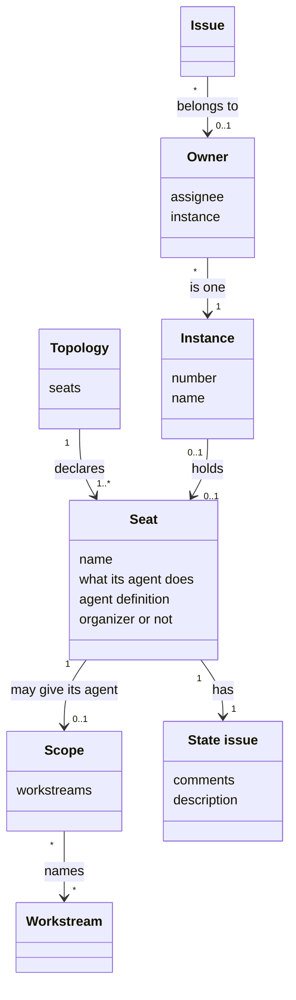
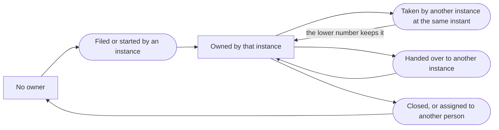
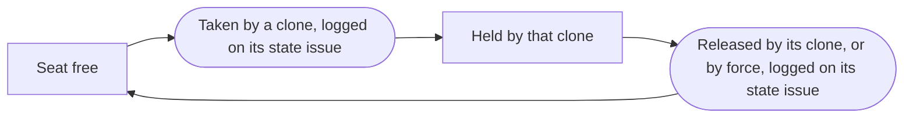

# VIEW-parallel-work — Parallel work

Several AI agents may work on one [project](../../core/glossary.md#term-project--project) at the same time, each in a clone of its own and often under one person's account. Each must know its own job, and no two may work on one [issue](../glossary.md#term-issue--issue). A [topology](../glossary.md#term-topology--topology) declares a [seat](../glossary.md#term-seat--seat) for each job, and a seat may give its agent a [scope](../glossary.md#term-scope--scope). Each agent works in an [instance](../glossary.md#term-instance--instance), and the [owner](../glossary.md#term-owner--owner) of an issue says which instance works on it (DEC-035 and DEC-045).

Each seat has a [state issue](../glossary.md#term-state-issue--state-issue), which shows which clone holds the seat now. The maintainer decided seats and state issues on 26 October, and no record holds them yet.

These concepts serve the use cases in [040-work-in-parallel](../overview/README.md#040-work-in-parallel). The journey [JRN-004](../use-case-model/journeys/JRN-004-set-up-and-adjust-topology.md) follows the adopter across those use cases, from setting up the topology to adjusting it on what the adopter measures.

## Topology

Defined in [TERM-topology](../glossary.md#term-topology--topology).

**Why:** Several clones work on one [project](../../core/glossary.md#term-project--project) at the same time, each with a distinct job. Work needs to reach the clone whose job it is (DEC-045).

A topology is the set of [seats](../glossary.md#term-seat--seat) a project declares for the AI agents that work on it at the same time. The maintainer decided on 25 October that a topology is shared through the project's committed configuration, so every clone reads the same one (#512).

**Attributes:**

- its seats (the maintainer, 26 October)

**Relations:**

- It declares one seat or more (the maintainer, 26 October).

**States:** None.

**Always true:**

- A topology names [workstreams](../glossary.md#term-workstream--workstream), and never changes one (DEC-045 point 3).

## Seat

Defined in [TERM-seat](../glossary.md#term-seat--seat).

**Why:** Each clone runs with a job of its own, such as one for data and one for a map. Each clone should know its own name and job (DEC-045).

A seat is one place in a [topology](../glossary.md#term-topology--topology), which one clone holds at a time. It says whether the clone's agent plans, builds or does both, and which [agent definition](../../core/glossary.md#term-agent-definition--agent-definition) that agent follows. A clone takes a seat, and the clone's agent then acts as the seat says. The maintainer decided seats on 26 October, and no record holds them yet.

**Attributes:**

- its name, which becomes the identity of the clone that takes it (DEC-045 point 1, and the maintainer, 26 October)
- whether its agent plans, builds or does both, as the planning agent, a worker agent or a lead agent (the maintainer, 26 October)
- the agent definition its agent follows, the project-manager agent's by default (DEC-029, and the maintainer, 26 October)
- a [scope](../glossary.md#term-scope--scope), which is optional (the maintainer, 26 October)
- whether it is the organizer seat, whose clone may release other seats by force (the maintainer, 26 October)

**Relations:**

- A topology declares it (the maintainer, 26 October).
- At most one clone holds it at a time, and that clone's agent acts in it (the maintainer, 26 October).
- It has one [state issue](../glossary.md#term-state-issue--state-issue), which logs each clone that takes it or releases it (the maintainer, 26 October).

**States:** A seat is free until a clone takes it, and is held until that clone releases it. In the first and most tolerant mode, nothing else frees it but a release by force, which its state issue logs.

**Always true:** None.

## Scope

Defined in [TERM-scope](../glossary.md#term-scope--scope).

**Why:** Work must reach the agent whose job it is. A [project](../../core/glossary.md#term-project--project) already divides its work into long-lived areas, so a scope names those areas rather than adding another way to divide the work (DEC-045).

A scope is the part of a project's work that one agent of a [topology](../glossary.md#term-topology--topology) takes its issues from. The accepted records give it as a set of [workstreams](../glossary.md#term-workstream--workstream). The maintainer decided on 26 October that a [seat](../glossary.md#term-seat--seat)'s scope is optional, by discipline first and by workstream later. A scope by discipline, such as design or testing, has no form yet.

**Attributes:**

- the workstreams it names (DEC-045 point 3)

**Relations:**

- A seat may give its agent one (the maintainer, 26 October).
- It names workstreams, and changes none of them (DEC-045 point 3).
- Two agents' scopes may name one workstream, and a workstream may lie in no scope (DEC-045 point 4).

**States:** None.

**Always true:**

- A workstream that two scopes name, or that no scope names, is allowed and warned of (DEC-045 point 4).

## Instance

Defined in [TERM-instance](../glossary.md#term-instance--instance).

**Why:** One person's clones all act under one GitHub account. Without a mark of their own, no clone can tell which work in flight is its own, and the clones step on each other (DEC-035).

An instance is a clone of a [project](../../core/glossary.md#term-project--project)'s repository that has set a number of its own. Sessions start and end in it, and the number stays. A clone that sets none works as clones did before instances existed.

**Attributes:**

- its number, one of a pool of four for each person (DEC-035 points 1 and 2)
- its name, such as `data` (DEC-045 point 1)

**Relations:**

- An agent of a [topology](../glossary.md#term-topology--topology) works in one instance (DEC-035 point 1).
- An instance holds at most one [seat](../glossary.md#term-seat--seat), whose name it takes (the maintainer, 26 October).
- An instance may be the [owner](../glossary.md#term-owner--owner) of issues (DEC-035 point 3).

**States:** A clone becomes an instance once it sets a number, and stops being one when the number is cleared (DEC-035 point 1).

**Always true:**

- The number lives only in its clone, and is never committed (DEC-035 point 1).
- An instance is never an input to a move of the [issue lifecycle](../glossary.md#term-issue-lifecycle--issue-lifecycle) (DEC-035 point 8).

## Owner

Defined in [TERM-owner](../glossary.md#term-owner--owner).

**Why:** Each clone must see which work is another's, and be kept from acting on it. GitHub offers no atomic claim, so the owner lets a clash be caught and resolved, though not prevented (DEC-035).

The owner of an [issue](../glossary.md#term-issue--issue) is the [instance](../glossary.md#term-instance--instance) it belongs to, from its filing or its start until its close, paired with the issue's assignee. The same person's other instances see the issue as another's, and leave it alone. Different people's instances never mix, since each person's numbers are their own.

**Attributes:**

- the assignee and the instance's number (DEC-035 point 2)
- where it is written: a label, or a log of comments on the issue with a summary in its description (DEC-043 points 2 to 4)

**Relations:**

- An issue has at most one owner once a clash is resolved (DEC-035 point 6).
- An instance that files work owns all of it, the parents and the Tasks under them (DEC-035 point 3).

**States:** An issue has no owner until an instance files it or starts it. A hand-over moves the owner to another instance. A close, or a new assignee, clears it (DEC-035 points 3 to 5).

**Always true:**

- Two instances that take one issue at the same instant end with one owner, the lower number (DEC-035 point 6).
- The owner is never an input to a gate, a move of the [issue lifecycle](../glossary.md#term-issue-lifecycle--issue-lifecycle) or the [cascade](../glossary.md#term-cascade--cascade) (DEC-035 point 8 and DEC-043 point 6).
- In the comment log, the comments are the record, and the summary in the description is rebuilt from them (DEC-043 points 3 and 4).

## State issue

Defined in [TERM-state-issue](../glossary.md#term-state-issue--state-issue).

**Why:** Clones coordinate through GitHub, the substrate they share (DEC-035). GitHub creates each comment whole, so clones that each post their own comment never overwrite each other (DEC-043 point 3).

A state issue holds one piece of shared data that changes while agents work, such as which clone holds a [seat](../glossary.md#term-seat--seat). It sits outside the hierarchy of work, and no one builds it. Its comments log each new value, and its description shows the current one, rebuilt from them. The maintainer decided state issues on 26 October, for any such data, and no record holds them yet.

**Attributes:**

- the data it holds, such as which clone holds one seat (the maintainer, 26 October)
- its comments, each logging one new value, and its description, which shows the current one (the pattern of DEC-043 points 3 and 4)

**Relations:**

- Each seat has one (the maintainer, 26 October).
- It is no [issue](../glossary.md#term-issue--issue) of work: it takes none of the four types, and sits under no parent (the maintainer, 26 October).

**States:** None.

**Always true:** None.

## What is built on these concepts

Each concept below lists the use cases, journeys and requirements whose text links its term.

**Topology:**

- [UC-082 — Set up my project's topology in its committed configuration, so that every clone reads the same seats](../use-case-model/use-cases/040-work-in-parallel/UC-082-set-up-topology.md)
- [UC-083 — Plan an intent into work for each scope of the topology](../use-case-model/use-cases/040-work-in-parallel/UC-083-plan-across-scopes.md)
- [UC-084 — Take my next ready Task, and build it up to its merge](../use-case-model/use-cases/040-work-in-parallel/UC-084-take-next-task.md)
- [UC-085 — Never work on a Task another agent already works on](../use-case-model/use-cases/040-work-in-parallel/UC-085-leave-task-to-its-owner.md)
- [UC-086 — Take up my instance's work after my session died](../use-case-model/use-cases/040-work-in-parallel/UC-086-resume-after-session-died.md)
- [UC-087 — Hand the next piece of the work to the scope that does it](../use-case-model/use-cases/040-work-in-parallel/UC-087-hand-over-to-next-scope.md)
- [UC-088 — Delegate a Task of my scope to an agent I start](../use-case-model/use-cases/040-work-in-parallel/UC-088-delegate-to-agent.md)
- [UC-089 — Land my Task while other agents land theirs](../use-case-model/use-cases/040-work-in-parallel/UC-089-land-alongside-others.md)
- [UC-090 — See which agent works on which issue, without visiting each agent](../use-case-model/use-cases/040-work-in-parallel/UC-090-see-who-works-on-what.md)
- [UC-091 — Measure one topology against another on comparable work](../use-case-model/use-cases/040-work-in-parallel/UC-091-measure-topologies.md)
- [UC-092 — Take a seat of my project's topology for my clone, and act as that seat's agent](../use-case-model/use-cases/040-work-in-parallel/UC-092-take-seat.md)
- [JRN-004 — Set up the topology my project runs, and adjust it on what I measure](../use-case-model/journeys/JRN-004-set-up-and-adjust-topology.md)

**Seat:**

- [UC-082 — Set up my project's topology in its committed configuration, so that every clone reads the same seats](../use-case-model/use-cases/040-work-in-parallel/UC-082-set-up-topology.md)
- [UC-084 — Take my next ready Task, and build it up to its merge](../use-case-model/use-cases/040-work-in-parallel/UC-084-take-next-task.md)
- [UC-085 — Never work on a Task another agent already works on](../use-case-model/use-cases/040-work-in-parallel/UC-085-leave-task-to-its-owner.md)
- [UC-086 — Take up my instance's work after my session died](../use-case-model/use-cases/040-work-in-parallel/UC-086-resume-after-session-died.md)
- [UC-087 — Hand the next piece of the work to the scope that does it](../use-case-model/use-cases/040-work-in-parallel/UC-087-hand-over-to-next-scope.md)
- [UC-090 — See which agent works on which issue, without visiting each agent](../use-case-model/use-cases/040-work-in-parallel/UC-090-see-who-works-on-what.md)
- [UC-092 — Take a seat of my project's topology for my clone, and act as that seat's agent](../use-case-model/use-cases/040-work-in-parallel/UC-092-take-seat.md)
- [JRN-004 — Set up the topology my project runs, and adjust it on what I measure](../use-case-model/journeys/JRN-004-set-up-and-adjust-topology.md)

**Scope:**

- [UC-082 — Set up my project's topology in its committed configuration, so that every clone reads the same seats](../use-case-model/use-cases/040-work-in-parallel/UC-082-set-up-topology.md)
- [UC-083 — Plan an intent into work for each scope of the topology](../use-case-model/use-cases/040-work-in-parallel/UC-083-plan-across-scopes.md)
- [UC-084 — Take my next ready Task, and build it up to its merge](../use-case-model/use-cases/040-work-in-parallel/UC-084-take-next-task.md)
- [UC-085 — Never work on a Task another agent already works on](../use-case-model/use-cases/040-work-in-parallel/UC-085-leave-task-to-its-owner.md)
- [UC-087 — Hand the next piece of the work to the scope that does it](../use-case-model/use-cases/040-work-in-parallel/UC-087-hand-over-to-next-scope.md)
- [UC-088 — Delegate a Task of my scope to an agent I start](../use-case-model/use-cases/040-work-in-parallel/UC-088-delegate-to-agent.md)
- [JRN-004 — Set up the topology my project runs, and adjust it on what I measure](../use-case-model/journeys/JRN-004-set-up-and-adjust-topology.md)

**Instance:**

- [UC-082 — Set up my project's topology in its committed configuration, so that every clone reads the same seats](../use-case-model/use-cases/040-work-in-parallel/UC-082-set-up-topology.md)
- [UC-083 — Plan an intent into work for each scope of the topology](../use-case-model/use-cases/040-work-in-parallel/UC-083-plan-across-scopes.md)
- [UC-084 — Take my next ready Task, and build it up to its merge](../use-case-model/use-cases/040-work-in-parallel/UC-084-take-next-task.md)
- [UC-085 — Never work on a Task another agent already works on](../use-case-model/use-cases/040-work-in-parallel/UC-085-leave-task-to-its-owner.md)
- [UC-086 — Take up my instance's work after my session died](../use-case-model/use-cases/040-work-in-parallel/UC-086-resume-after-session-died.md)
- [UC-087 — Hand the next piece of the work to the scope that does it](../use-case-model/use-cases/040-work-in-parallel/UC-087-hand-over-to-next-scope.md)
- [UC-088 — Delegate a Task of my scope to an agent I start](../use-case-model/use-cases/040-work-in-parallel/UC-088-delegate-to-agent.md)
- [UC-090 — See which agent works on which issue, without visiting each agent](../use-case-model/use-cases/040-work-in-parallel/UC-090-see-who-works-on-what.md)
- [UC-091 — Measure one topology against another on comparable work](../use-case-model/use-cases/040-work-in-parallel/UC-091-measure-topologies.md)
- [UC-092 — Take a seat of my project's topology for my clone, and act as that seat's agent](../use-case-model/use-cases/040-work-in-parallel/UC-092-take-seat.md)
- [REQ-061 · Functional · No two instances keep working on one issue](../requirements/functional/040-work-in-parallel/REQ-061-one-owner-per-issue.md)
- [REQ-062 · Functional · An instance's work in flight is found again from GitHub and the instance's number alone](../requirements/functional/040-work-in-parallel/REQ-062-work-found-from-tracker.md)

**Owner:**

- [UC-082 — Set up my project's topology in its committed configuration, so that every clone reads the same seats](../use-case-model/use-cases/040-work-in-parallel/UC-082-set-up-topology.md)
- [UC-083 — Plan an intent into work for each scope of the topology](../use-case-model/use-cases/040-work-in-parallel/UC-083-plan-across-scopes.md)
- [UC-084 — Take my next ready Task, and build it up to its merge](../use-case-model/use-cases/040-work-in-parallel/UC-084-take-next-task.md)
- [UC-085 — Never work on a Task another agent already works on](../use-case-model/use-cases/040-work-in-parallel/UC-085-leave-task-to-its-owner.md)
- [UC-086 — Take up my instance's work after my session died](../use-case-model/use-cases/040-work-in-parallel/UC-086-resume-after-session-died.md)
- [UC-087 — Hand the next piece of the work to the scope that does it](../use-case-model/use-cases/040-work-in-parallel/UC-087-hand-over-to-next-scope.md)
- [UC-088 — Delegate a Task of my scope to an agent I start](../use-case-model/use-cases/040-work-in-parallel/UC-088-delegate-to-agent.md)
- [UC-090 — See which agent works on which issue, without visiting each agent](../use-case-model/use-cases/040-work-in-parallel/UC-090-see-who-works-on-what.md)
- [JRN-004 — Set up the topology my project runs, and adjust it on what I measure](../use-case-model/journeys/JRN-004-set-up-and-adjust-topology.md)
- [REQ-062 · Functional · An instance's work in flight is found again from GitHub and the instance's number alone](../requirements/functional/040-work-in-parallel/REQ-062-work-found-from-tracker.md)

**State issue:**

- [UC-082 — Set up my project's topology in its committed configuration, so that every clone reads the same seats](../use-case-model/use-cases/040-work-in-parallel/UC-082-set-up-topology.md)
- [UC-085 — Never work on a Task another agent already works on](../use-case-model/use-cases/040-work-in-parallel/UC-085-leave-task-to-its-owner.md)
- [UC-090 — See which agent works on which issue, without visiting each agent](../use-case-model/use-cases/040-work-in-parallel/UC-090-see-who-works-on-what.md)
- [UC-092 — Take a seat of my project's topology for my clone, and act as that seat's agent](../use-case-model/use-cases/040-work-in-parallel/UC-092-take-seat.md)
