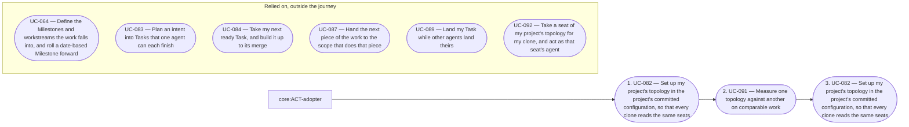

# Overview of the analysis of project-management

<!-- pkit:overview reads=5 fingerprint=sha256:ec8bea2698e84f3477192e7f2ec470c7e7d847c380b21cecf3aad52a6da7a481 -->

[project-management exists so a team runs its projects' work on GitHub by one rulebook, which agents carry out on a person's authority](../../../../.pkit/capabilities/project-management/decisions/DEC-057-purpose.md).

This analysis describes what project-management does: who uses it, what they do with it, and what it must meet. It builds on the analysis of core.

## Areas

### 010-plan

Define the Milestones and workstreams a project's work falls into, and plan each intent into an EPIC and the work under it.

**Builds on:** no other area.

**Its concepts:**

- [010 — Issues and their hierarchy](../domain-model/010-issues-and-their-hierarchy.md)
- [020 — Classification of issues](../domain-model/020-classification-of-issues.md)
- [030 — The issue lifecycle](../domain-model/030-the-issue-lifecycle.md)
- [050 — Batch planning](../domain-model/050-batch-planning.md)

**Its requirements:** none.

**Its use cases:**

- [UC-063 — Plan an intent into an EPIC and its work, filed once I approve the plan](../use-case-model/use-cases/010-plan/UC-063-plan-intent.md) ([not built yet](#not-built-yet): step 8)
- [UC-064 — Define the Milestones and workstreams the work falls into, and roll a date-based Milestone forward](../use-case-model/use-cases/010-plan/UC-064-define-milestones-and-workstreams.md) ([not built yet](#not-built-yet): step 4, step 9, variant 11a)

### 020-file-and-move

File each Task under its parent, and move each issue through its lifecycle, each filing and each move checked.

**Builds on:** [010-plan](#010-plan).

**Its concepts:**

- [010 — Issues and their hierarchy](../domain-model/010-issues-and-their-hierarchy.md)
- [020 — Classification of issues](../domain-model/020-classification-of-issues.md)
- [030 — The issue lifecycle](../domain-model/030-the-issue-lifecycle.md)
- [050 — Batch planning](../domain-model/050-batch-planning.md)

**Its requirements:** none.

**Its use cases:**

- [UC-060 — File a Task under its parent, its title and body checked as it is filed](../use-case-model/use-cases/020-file-and-move/UC-060-file-task.md) ([not built yet](#not-built-yet): step 6, step 8, variant 6c, variant 6e)
- [UC-061 — Move my issue through its lifecycle, each move checked](../use-case-model/use-cases/020-file-and-move/UC-061-move-issue.md) ([not built yet](#not-built-yet): step 4, step 7, variant 1a, variant 7a)

### 030-review-and-land

Have each pull request reviewed by the reviewers its change requires, and land it once the merge authoriser authorises its head.

**Builds on:** [020-file-and-move](#020-file-and-move).

**Its concepts:**

- [010 — Issues and their hierarchy](../domain-model/010-issues-and-their-hierarchy.md)
- [030 — The issue lifecycle](../domain-model/030-the-issue-lifecycle.md)
- [040 — Reviews and the merge](../domain-model/040-reviews-and-the-merge.md)

**Its requirements:** none.

**Its use cases:**

- [UC-062 — Have the reviewers my change requires review my pull request, and land it](../use-case-model/use-cases/030-review-and-land/UC-062-review-and-land.md) ([not built yet](#not-built-yet): variant 1b, step 9)

### 040-work-in-parallel

Run several AI agents on one project at once, each on its own scope and never on another's issue, and see and measure their work.

**Builds on:** [010-plan](#010-plan) and [020-file-and-move](#020-file-and-move).

**Its concepts:**

- [010 — Issues and their hierarchy](../domain-model/010-issues-and-their-hierarchy.md)
- [020 — Classification of issues](../domain-model/020-classification-of-issues.md)
- [030 — The issue lifecycle](../domain-model/030-the-issue-lifecycle.md)
- [040 — Reviews and the merge](../domain-model/040-reviews-and-the-merge.md)
- [060 — Parallel work](../domain-model/060-parallel-work.md)

**Its requirements:**

- [REQ-061 · Functional · No two instances keep working on one issue](../requirements/functional/040-work-in-parallel/REQ-061-one-owner-per-issue.md)
- [REQ-062 · Functional · An instance's work in flight is found again from GitHub and the instance's number alone](../requirements/functional/040-work-in-parallel/REQ-062-work-found-from-tracker.md)

**Its use cases:**

- [UC-082 — Set up my project's topology in the project's committed configuration, so that every clone reads the same seats](../use-case-model/use-cases/040-work-in-parallel/UC-082-set-up-topology.md) ([not built yet](#not-built-yet): step 4, step 5, variant 4a, variant 8a)
- [UC-083 — Plan an intent into Tasks that one agent can each finish](../use-case-model/use-cases/040-work-in-parallel/UC-083-plan-across-scopes.md) ([not built yet](#not-built-yet): step 10, variant 1a)
- [UC-084 — Take my next ready Task, and build it up to its merge](../use-case-model/use-cases/040-work-in-parallel/UC-084-take-next-task.md) ([not built yet](#not-built-yet): step 1, step 5, step 6, step 9, variant 2a, variant 2b, variant 3a, variant 9a)
- [UC-085 — Never work on a Task another agent already works on](../use-case-model/use-cases/040-work-in-parallel/UC-085-leave-task-to-its-owner.md) ([not built yet](#not-built-yet): step 2, step 3, variant 1a, variant 2a, variant 3a, variant 3b, variant 3c)
- [UC-086 — Take up my instance's work after my session died](../use-case-model/use-cases/040-work-in-parallel/UC-086-resume-after-session-died.md) ([not built yet](#not-built-yet): step 2, variant 1a, variant 2a, variant 2b, variant 2c)
- [UC-087 — Hand the next piece of the work to the scope that does that piece](../use-case-model/use-cases/040-work-in-parallel/UC-087-hand-over-to-next-scope.md) ([not built yet](#not-built-yet): variant 1a, variant 4a)
- [UC-088 — Delegate a Task of my scope to a helper agent](../use-case-model/use-cases/040-work-in-parallel/UC-088-delegate-to-agent.md) ([not built yet](#not-built-yet): step 1)
- [UC-089 — Land my Task while other agents land theirs](../use-case-model/use-cases/040-work-in-parallel/UC-089-land-alongside-others.md)
- [UC-090 — See which agent works on which issue, without visiting each agent](../use-case-model/use-cases/040-work-in-parallel/UC-090-see-who-works-on-what.md) ([not built yet](#not-built-yet): step 1)
- [UC-091 — Measure one topology against another on comparable work](../use-case-model/use-cases/040-work-in-parallel/UC-091-measure-topologies.md)
- [UC-092 — Take a seat of my project's topology for my clone, and act as that seat's agent](../use-case-model/use-cases/040-work-in-parallel/UC-092-take-seat.md) ([not built yet](#not-built-yet): variant 3b)

## Reference

### Who takes part

| Actor | Who they are | Areas they act in |
| --- | --- | --- |
| [ACT-lead-agent — Lead agent](../use-case-model/actors/ACT-lead-agent.md) | An AI agent of a topology that plans and builds the work of the agent's scope, delegating Tasks to helper agents the agent starts. | [040-work-in-parallel](#040-work-in-parallel) |
| [ACT-planner — Planner](../use-case-model/actors/ACT-planner.md) | The person who plans a project's work at the level of its outcomes. | [010-plan](#010-plan), [040-work-in-parallel](#040-work-in-parallel) |
| [ACT-planning-agent — Planning agent](../use-case-model/actors/ACT-planning-agent.md) | An AI agent of a topology that slices a project's work and files the work for the other agents, and builds none of the work. | [040-work-in-parallel](#040-work-in-parallel) |
| [ACT-worker-agent — Worker agent](../use-case-model/actors/ACT-worker-agent.md) | An AI agent of a topology that takes ready Tasks one at a time, and builds each up to its merge. | [040-work-in-parallel](#040-work-in-parallel) |
| core:ACT-adopter — Adopter | An actor of the analysis of core, which the head of the [glossary](../glossary.md) lists. | [040-work-in-parallel](#040-work-in-parallel) |
| core:ACT-ai-agent — AI agent | An actor of the analysis of core, which the head of the [glossary](../glossary.md) lists. | [010-plan](#010-plan), [020-file-and-move](#020-file-and-move), [030-review-and-land](#030-review-and-land), [040-work-in-parallel](#040-work-in-parallel) |
| core:ACT-ci-pipeline — CI pipeline | An actor of the analysis of core, which the head of the [glossary](../glossary.md) lists. | [030-review-and-land](#030-review-and-land), [040-work-in-parallel](#040-work-in-parallel) |
| core:ACT-developer — Developer | An actor of the analysis of core, which the head of the [glossary](../glossary.md) lists. | [020-file-and-move](#020-file-and-move), [030-review-and-land](#030-review-and-land), [040-work-in-parallel](#040-work-in-parallel) |
| core:ACT-merge-authoriser — Merge authoriser | An actor of the analysis of core, which the head of the [glossary](../glossary.md) lists. | [030-review-and-land](#030-review-and-land), [040-work-in-parallel](#040-work-in-parallel) |
| core:ACT-operator — Operator | An actor of the analysis of core, which the head of the [glossary](../glossary.md) lists. | [010-plan](#010-plan), [020-file-and-move](#020-file-and-move), [030-review-and-land](#030-review-and-land), [040-work-in-parallel](#040-work-in-parallel) |

### Concepts

The [glossary](../glossary.md) defines each term.

Each view of the domain model explains a group of related concepts:

- [010 — Issues and their hierarchy](../domain-model/010-issues-and-their-hierarchy.md)
- [020 — Classification of issues](../domain-model/020-classification-of-issues.md)
- [030 — The issue lifecycle](../domain-model/030-the-issue-lifecycle.md)
- [040 — Reviews and the merge](../domain-model/040-reviews-and-the-merge.md)
- [050 — Batch planning](../domain-model/050-batch-planning.md)
- [060 — Parallel work](../domain-model/060-parallel-work.md)

### Requirements in no area

- [REQ-040 · Constraint · project-management works on GitHub alone, through an authenticated gh](../requirements/constraints/REQ-040-github-and-gh.md)
- [REQ-041 · Functional · A command that writes checks the project's prerequisites and the person's membership first](../requirements/functional/REQ-041-gates-before-writing.md)
- [REQ-042 · Functional · A move a person holds is made only on that person's authorisation](../requirements/functional/REQ-042-held-moves-authorised.md)

### Journeys

#### [JRN-004 — Set up the topology my project runs, and adjust the topology on what I measure](../use-case-model/journeys/JRN-004-set-up-and-adjust-topology.md)

### Not built yet

What the use cases describe and the system does not do yet, each with the record that decides it and the issue that tracks it (software-analysis DEC-001 point 1):

- [UC-060 — File a Task under its parent, its title and body checked as it is filed](../use-case-model/use-cases/020-file-and-move/UC-060-file-task.md): step 6, decided by `project-management:DEC-005`, tracked in `#1313`
- [UC-060 — File a Task under its parent, its title and body checked as it is filed](../use-case-model/use-cases/020-file-and-move/UC-060-file-task.md): step 8, decided by `project-management:DEC-005`, tracked in `#1314`
- [UC-060 — File a Task under its parent, its title and body checked as it is filed](../use-case-model/use-cases/020-file-and-move/UC-060-file-task.md): variant 6c, decided by `project-management:DEC-005`, tracked in `#1313`
- [UC-060 — File a Task under its parent, its title and body checked as it is filed](../use-case-model/use-cases/020-file-and-move/UC-060-file-task.md): variant 6e, decided by `project-management:DEC-005`, tracked in `#1314`
- [UC-061 — Move my issue through its lifecycle, each move checked](../use-case-model/use-cases/020-file-and-move/UC-061-move-issue.md): step 4, decided by `project-management:DEC-052`, tracked in `#756`
- [UC-061 — Move my issue through its lifecycle, each move checked](../use-case-model/use-cases/020-file-and-move/UC-061-move-issue.md): step 7, decided by `project-management:DEC-013`, tracked in `#1761`
- [UC-061 — Move my issue through its lifecycle, each move checked](../use-case-model/use-cases/020-file-and-move/UC-061-move-issue.md): variant 1a, decided by `COR-004`, tracked in `#1938`
- [UC-061 — Move my issue through its lifecycle, each move checked](../use-case-model/use-cases/020-file-and-move/UC-061-move-issue.md): variant 7a, decided by `project-management:DEC-007`, tracked in `#1215`
- [UC-062 — Have the reviewers my change requires review my pull request, and land it](../use-case-model/use-cases/030-review-and-land/UC-062-review-and-land.md): variant 1b, decided by `COR-004`, tracked in `#1938`
- [UC-062 — Have the reviewers my change requires review my pull request, and land it](../use-case-model/use-cases/030-review-and-land/UC-062-review-and-land.md): step 9, decided by `COR-064#2`, tracked in `#2122`
- [UC-063 — Plan an intent into an EPIC and its work, filed once I approve the plan](../use-case-model/use-cases/010-plan/UC-063-plan-intent.md): step 8, decided by `project-management:DEC-014`, tracked in `#1761`
- [UC-064 — Define the Milestones and workstreams the work falls into, and roll a date-based Milestone forward](../use-case-model/use-cases/010-plan/UC-064-define-milestones-and-workstreams.md): step 4, decided by `project-management:DEC-016`, tracked in `#1939`
- [UC-064 — Define the Milestones and workstreams the work falls into, and roll a date-based Milestone forward](../use-case-model/use-cases/010-plan/UC-064-define-milestones-and-workstreams.md): step 9, decided by `project-management:DEC-016`, tracked in `#1939`
- [UC-064 — Define the Milestones and workstreams the work falls into, and roll a date-based Milestone forward](../use-case-model/use-cases/010-plan/UC-064-define-milestones-and-workstreams.md): variant 11a, decided by `project-management:DEC-016`, tracked in `#1939`
- [UC-082 — Set up my project's topology in the project's committed configuration, so that every clone reads the same seats](../use-case-model/use-cases/040-work-in-parallel/UC-082-set-up-topology.md): step 4, decided by `project-management:DEC-045#6`, tracked in `#512`
- [UC-082 — Set up my project's topology in the project's committed configuration, so that every clone reads the same seats](../use-case-model/use-cases/040-work-in-parallel/UC-082-set-up-topology.md): step 5, decided by `project-management:DEC-059#7`, tracked in `#2136`
- [UC-082 — Set up my project's topology in the project's committed configuration, so that every clone reads the same seats](../use-case-model/use-cases/040-work-in-parallel/UC-082-set-up-topology.md): variant 4a, decided by `project-management:DEC-045#6`, tracked in `#512`
- [UC-082 — Set up my project's topology in the project's committed configuration, so that every clone reads the same seats](../use-case-model/use-cases/040-work-in-parallel/UC-082-set-up-topology.md): variant 8a, decided by `project-management:DEC-059#1`, tracked in `#2177`
- [UC-083 — Plan an intent into Tasks that one agent can each finish](../use-case-model/use-cases/040-work-in-parallel/UC-083-plan-across-scopes.md): step 10, decided by `project-management:DEC-059#7`, tracked in `#2136`
- [UC-083 — Plan an intent into Tasks that one agent can each finish](../use-case-model/use-cases/040-work-in-parallel/UC-083-plan-across-scopes.md): variant 1a, decided by `project-management:DEC-035#3`, tracked in `#519`
- [UC-084 — Take my next ready Task, and build it up to its merge](../use-case-model/use-cases/040-work-in-parallel/UC-084-take-next-task.md): step 1, decided by `project-management:DEC-035#7`, tracked in `#521`
- [UC-084 — Take my next ready Task, and build it up to its merge](../use-case-model/use-cases/040-work-in-parallel/UC-084-take-next-task.md): step 5, decided by `project-management:DEC-035#3`, tracked in `#519`
- [UC-084 — Take my next ready Task, and build it up to its merge](../use-case-model/use-cases/040-work-in-parallel/UC-084-take-next-task.md): step 5, decided by `project-management:DEC-059#9`, tracked in `#519`
- [UC-084 — Take my next ready Task, and build it up to its merge](../use-case-model/use-cases/040-work-in-parallel/UC-084-take-next-task.md): step 6, decided by `project-management:DEC-035#6`, tracked in `#519`
- [UC-084 — Take my next ready Task, and build it up to its merge](../use-case-model/use-cases/040-work-in-parallel/UC-084-take-next-task.md): step 9, decided by `project-management:DEC-059#9`, tracked in `#2136`
- [UC-084 — Take my next ready Task, and build it up to its merge](../use-case-model/use-cases/040-work-in-parallel/UC-084-take-next-task.md): variant 2a, decided by `project-management:DEC-035#4`, tracked in `#521`
- [UC-084 — Take my next ready Task, and build it up to its merge](../use-case-model/use-cases/040-work-in-parallel/UC-084-take-next-task.md): variant 2b, decided by `project-management:DEC-059#9`, tracked in `#2136`
- [UC-084 — Take my next ready Task, and build it up to its merge](../use-case-model/use-cases/040-work-in-parallel/UC-084-take-next-task.md): variant 3a, decided by `project-management:DEC-045#5`, tracked in `#2136`
- [UC-084 — Take my next ready Task, and build it up to its merge](../use-case-model/use-cases/040-work-in-parallel/UC-084-take-next-task.md): variant 9a, decided by `project-management:DEC-059#9`, tracked in `#2136`
- [UC-085 — Never work on a Task another agent already works on](../use-case-model/use-cases/040-work-in-parallel/UC-085-leave-task-to-its-owner.md): step 2, decided by `project-management:DEC-035#6`, tracked in `#520`
- [UC-085 — Never work on a Task another agent already works on](../use-case-model/use-cases/040-work-in-parallel/UC-085-leave-task-to-its-owner.md): step 3, decided by `project-management:DEC-035#6`, tracked in `#520`
- [UC-085 — Never work on a Task another agent already works on](../use-case-model/use-cases/040-work-in-parallel/UC-085-leave-task-to-its-owner.md): variant 1a, decided by `project-management:DEC-035#6`, tracked in `#520`
- [UC-085 — Never work on a Task another agent already works on](../use-case-model/use-cases/040-work-in-parallel/UC-085-leave-task-to-its-owner.md): variant 2a, decided by `project-management:DEC-035#6`, tracked in `#519`
- [UC-085 — Never work on a Task another agent already works on](../use-case-model/use-cases/040-work-in-parallel/UC-085-leave-task-to-its-owner.md): variant 3a, decided by `project-management:DEC-035#6`, tracked in `#520`
- [UC-085 — Never work on a Task another agent already works on](../use-case-model/use-cases/040-work-in-parallel/UC-085-leave-task-to-its-owner.md): variant 3b, decided by `project-management:DEC-035#4`, tracked in `#521`
- [UC-085 — Never work on a Task another agent already works on](../use-case-model/use-cases/040-work-in-parallel/UC-085-leave-task-to-its-owner.md): variant 3c, decided by `project-management:DEC-059#9`, tracked in `#2136`
- [UC-086 — Take up my instance's work after my session died](../use-case-model/use-cases/040-work-in-parallel/UC-086-resume-after-session-died.md): step 2, decided by `project-management:DEC-035#7`, tracked in `#521`
- [UC-086 — Take up my instance's work after my session died](../use-case-model/use-cases/040-work-in-parallel/UC-086-resume-after-session-died.md): variant 1a, decided by `project-management:DEC-059#9`, tracked in `#519`
- [UC-086 — Take up my instance's work after my session died](../use-case-model/use-cases/040-work-in-parallel/UC-086-resume-after-session-died.md): variant 2a, decided by `project-management:DEC-035#6`, tracked in `#520`
- [UC-086 — Take up my instance's work after my session died](../use-case-model/use-cases/040-work-in-parallel/UC-086-resume-after-session-died.md): variant 2b, decided by `project-management:DEC-059#9`, tracked in `#2136`
- [UC-086 — Take up my instance's work after my session died](../use-case-model/use-cases/040-work-in-parallel/UC-086-resume-after-session-died.md): variant 2c, decided by `project-management:DEC-059#9`, tracked in `#2136`
- [UC-087 — Hand the next piece of the work to the scope that does that piece](../use-case-model/use-cases/040-work-in-parallel/UC-087-hand-over-to-next-scope.md): variant 1a, decided by `project-management:DEC-035#4`, tracked in `#521`
- [UC-087 — Hand the next piece of the work to the scope that does that piece](../use-case-model/use-cases/040-work-in-parallel/UC-087-hand-over-to-next-scope.md): variant 4a, decided by `project-management:DEC-035#3`, tracked in `#519`
- [UC-088 — Delegate a Task of my scope to a helper agent](../use-case-model/use-cases/040-work-in-parallel/UC-088-delegate-to-agent.md): step 1, decided by `project-management:DEC-035#3`, tracked in `#519`
- [UC-090 — See which agent works on which issue, without visiting each agent](../use-case-model/use-cases/040-work-in-parallel/UC-090-see-who-works-on-what.md): step 1, decided by `project-management:DEC-035#7`, tracked in `#521`
- [UC-090 — See which agent works on which issue, without visiting each agent](../use-case-model/use-cases/040-work-in-parallel/UC-090-see-who-works-on-what.md): step 1, decided by `project-management:DEC-059#6`, tracked in `#521`
- [UC-092 — Take a seat of my project's topology for my clone, and act as that seat's agent](../use-case-model/use-cases/040-work-in-parallel/UC-092-take-seat.md): variant 3b, decided by `project-management:DEC-059#8`, tracked in `#2136`

### Diagrams

`pkit analysis diagram --analysis project-management` prints this analysis's diagrams from the working tree. Its subjects are `use-cases`, `journeys`, `requirements` and `chain`, or a journey's or a requirement's id.

---

The command `pkit analysis overview` writes this page from the analysis. Change the analysis, never this page (software-analysis DEC-003 point 8).
