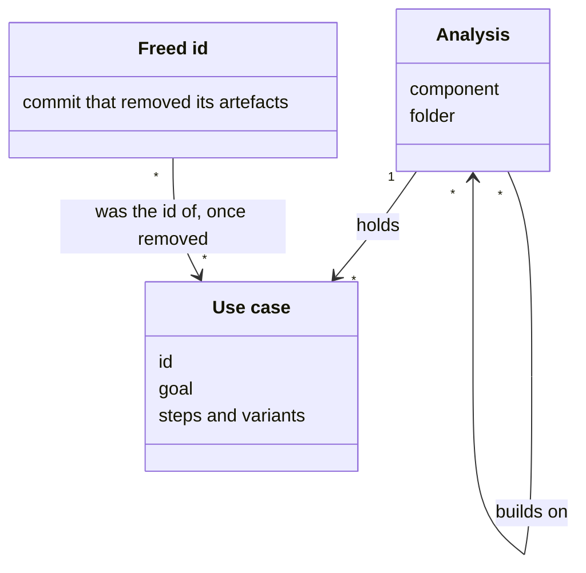
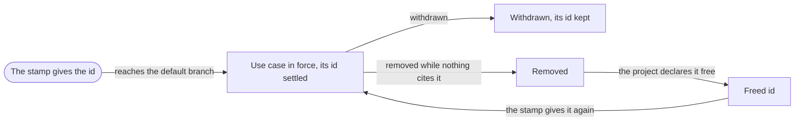

# VIEW-analyses-and-use-cases — Analyses, use cases and their ids

A [project](../../core/glossary.md#term-project--project) needs a written account of what its software must do, which decays silently as the code changes (DEC-001). An [analysis](../glossary.md#term-analysis--analysis) is that account for one [component](../../core/glossary.md#term-component--component), kept true by what it rests on. Its [use cases](../glossary.md#term-use-case--use-case) hold each goal and how the [system](../../core/glossary.md#term-system--system) meets it. Each id, once settled, names one [artefact](../../core/glossary.md#term-artefact--artefact) for good, save a [freed id](../glossary.md#term-freed-id--freed-id).

## Analysis

Defined in [TERM-analysis](../glossary.md#term-analysis--analysis).

**Why:** An account of what the software must do decays silently, in three steps:

- the code changes
- the account stays as it was
- nobody notices until a reader is misled

A [component](../../core/glossary.md#term-component--component) owns what describes it, so its account changes with it and at its pace (DEC-001).

An analysis says what one component must do, and for whom: its actors, its [use cases](../glossary.md#term-use-case--use-case), its journeys, its terms and its requirements. It lies in the internal documentation of the repository where its component is developed. Where a [project](../../core/glossary.md#term-project--project) keeps several, each lies in a folder named after its component.

**Attributes:**

- the component it describes, and the folder it lies in (DEC-001 point 2)
- the analyses it builds on, those of the components its component depends on (DEC-001 point 2)
- its own [artefacts](../../core/glossary.md#term-artefact--artefact), each with an id unique across the repository (DEC-001 points 2 and 3)

**Relations:**

- It describes one component, such as the methodology's core or one of its [capabilities](../../core/glossary.md#term-capability--capability) (DEC-001 point 2).
- It builds on the analyses of the components its component depends on, required or optional, and names no other (DEC-001 point 2).
- It holds its use cases (DEC-001 point 2).

**States:** None.

**Always true:**

- An analysis never ships with its component, so whoever receives the component receives no analysis (DEC-001 point 2).
- It points at the solution by anchors, and nothing in the solution points back at it (DEC-001 point 11).

## Use case

Defined in [TERM-use-case](../glossary.md#term-use-case--use-case).

**Why:** A use case is true of the product for as long as the product supports it. Kept apart from any one design, it persists after that design ships, and the design's review of it stays with the design (DEC-001).

A use case states one actor's goal and how the [system](../../core/glossary.md#term-system--system) fulfils it, with the other actors who take part. Its main path of steps and the variants that branch from them say what the system must do, as the accepted [decision records](../../core/glossary.md#term-decision-record--decision-record) decide it.

**Attributes:**

- its id, `UC-` and a number from one numbering across the repository's analyses (DEC-001 point 3)
- its actor, its goal and its other actors (DEC-001 point 1)
- its preconditions, each naming the use cases that make it true, in `after` where it writes one (DEC-001 point 1)
- its main path of numbered steps, and its variants, each lettered after the step it branches from (DEC-001 point 3)

**Relations:**

- It belongs to one [analysis](../glossary.md#term-analysis--analysis), and anchors its actors and the decisions it rests on or is answered by (DEC-001 points 2 and 4).
- A precondition's producers are use cases of its own analysis. A use case may name itself there, as a release starts from the last release (DEC-001 point 1).

**States:** A use case is in force until it is withdrawn. A withdrawn one keeps its file and its id, and is never deleted (DEC-001 point 3).

**Always true:**

- Its steps and variants keep their numbers and letters. A new one goes past them, and one that no longer happens stays under its number (DEC-001 point 3).
- Once settled, its id names it for good, unless the [project](../../core/glossary.md#term-project--project) frees the id once nothing cites it (DEC-001 point 3).

## Freed id

Defined in [TERM-freed-id](../glossary.md#term-freed-id--freed-id).

**Why:** An id is never reused, so that whatever cites it keeps naming the [artefact](../../core/glossary.md#term-artefact--artefact) it meant. A pilot abandoned before anything cited it leaves ids that name nothing anyone reads. Without a way to free them, an [analysis](../glossary.md#term-analysis--analysis) would count past them for good (DEC-001).

A freed id is the id of a removed [use case](../glossary.md#term-use-case--use-case), journey or requirement that the [project](../../core/glossary.md#term-project--project) declares free again. The project names the commit that removed the artefacts, and lists their ids. The [stamp](../../core/glossary.md#term-stamp--stamp) may then give each id again, as though it was never given.

**Attributes:**

- the commit that removed its artefacts, by its full id (DEC-001 point 3)
- what it was the id of: a use case, a journey or a requirement (DEC-001 point 3)

**Relations:**

- It was the id of use cases, journeys or requirements of an analysis, removed from the [default branch](../../core/glossary.md#term-default-branch--default-branch) (DEC-001 point 3).

**States:** An id is settled once its artefact reaches the default branch. Once its artefacts are removed and the project declares the id free, it is free until the stamp gives it again (DEC-001 point 3).

**Always true:**

- Only the project frees an id, and no tool infers one (DEC-001 point 3).
- Nothing frees an id but that declaration, which names only ids that nothing cites (DEC-001 point 3).

## What is built on these concepts

Each concept below lists the use cases, journeys and requirements whose text links its term.

**Analysis:**

- [UC-070 — Choose the parts of each kind of analysis artefact as I adopt software analysis](../use-case-model/use-cases/UC-070-choose-parts.md)
- [UC-071 — Describe my existing project from its code, documents and decisions](../use-case-model/use-cases/UC-071-describe-existing-project.md)
- [UC-072 — Revise the analysis before a proposed change is built](../use-case-model/use-cases/UC-072-revise-before-change.md)
- [UC-073 — Revalidate the analysis after a change from an agent's proposed outcomes](../use-case-model/use-cases/UC-073-revalidate-after-change.md)
- [UC-074 — Free the ids of artefacts nothing cites](../use-case-model/use-cases/UC-074-free-uncited-ids.md)

**Use case:**

- [UC-070 — Choose the parts of each kind of analysis artefact as I adopt software analysis](../use-case-model/use-cases/UC-070-choose-parts.md)
- [UC-071 — Describe my existing project from its code, documents and decisions](../use-case-model/use-cases/UC-071-describe-existing-project.md)
- [UC-072 — Revise the analysis before a proposed change is built](../use-case-model/use-cases/UC-072-revise-before-change.md)
- [UC-073 — Revalidate the analysis after a change from an agent's proposed outcomes](../use-case-model/use-cases/UC-073-revalidate-after-change.md)
- [UC-074 — Free the ids of artefacts nothing cites](../use-case-model/use-cases/UC-074-free-uncited-ids.md)

**Freed id:**

- [UC-071 — Describe my existing project from its code, documents and decisions](../use-case-model/use-cases/UC-071-describe-existing-project.md)
- [UC-074 — Free the ids of artefacts nothing cites](../use-case-model/use-cases/UC-074-free-uncited-ids.md)
