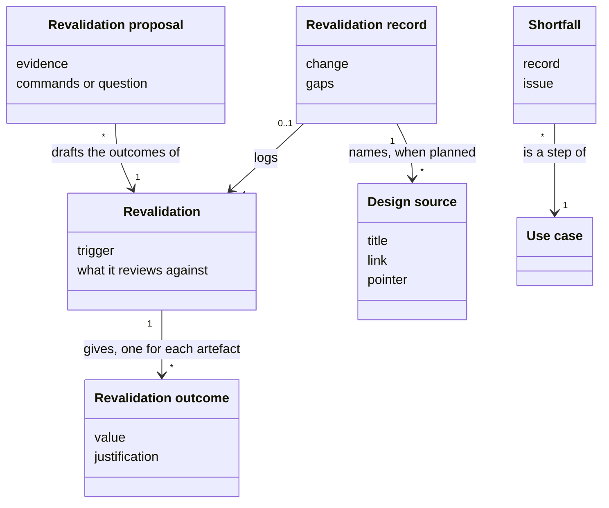
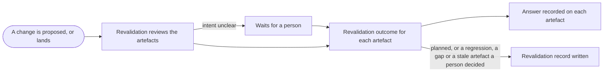

# VIEW-revalidations — Revalidations and what they find

When something an [analysis](../glossary.md#term-analysis--analysis) rests on changes, someone must judge whether each description still holds. A wrong judgement either rewrites the truth to match a bug, or reports a defect for an intended [change](../../core/glossary.md#term-change--change) ([DEC-001](../../../../.pkit/capabilities/software-analysis/decisions/DEC-001-software-analysis-discipline.md)). A [revalidation](../glossary.md#term-revalidation--revalidation) is that judgement, before code or after it, and it ends in a [revalidation outcome](../glossary.md#term-revalidation-outcome--revalidation-outcome) for each [artefact](../../core/glossary.md#term-artefact--artefact) it covers. Three things go with it:

- a [revalidation proposal](../glossary.md#term-revalidation-proposal--revalidation-proposal) drafts the outcomes
- a [revalidation record](../glossary.md#term-revalidation-record--revalidation-record) logs a revalidation with something to say
- a [shortfall](../glossary.md#term-shortfall--shortfall) is a step not built yet

## Revalidation

Defined in [TERM-revalidation](../glossary.md#term-revalidation--revalidation).

**Why:** Checking the [analysis](../glossary.md#term-analysis--analysis) before code and checking it after an unplanned [change](../../core/glossary.md#term-change--change) are the same act with different triggers. One set of outcomes, and one shape of record, serve both ([DEC-001](../../../../.pkit/capabilities/software-analysis/decisions/DEC-001-software-analysis-discipline.md)).

A revalidation reviews some analysis [artefacts](../../core/glossary.md#term-artefact--artefact) against one state of the [system](../../core/glossary.md#term-system--system): a proposed design before its code, or the code after a change. It asks whether each description is still true of the software, and usually mends the description. Whoever performs it, a person or an agent, records its result on each artefact it covered.

**Attributes:**

- its trigger: planned, drift, scheduled, close or onboarding ([DEC-001 point 5](../../../../.pkit/capabilities/software-analysis/decisions/DEC-001-software-analysis-discipline.md#5-revalidation))
- what it reviews against: a proposed design, or the code (DEC-001 point 5)
- the artefacts it covers, each with its [revalidation outcome](../glossary.md#term-revalidation-outcome--revalidation-outcome) (DEC-001 point 5)

**Relations:**

- It gives each artefact it covers one revalidation outcome (DEC-001 point 5).
- Its result on each artefact is recorded as the core's [answer](../../core/glossary.md#term-answer--answer), which clears the artefact's [friction](../../core/glossary.md#term-friction--friction) ([DEC-001 point 4](../../../../.pkit/capabilities/software-analysis/decisions/DEC-001-software-analysis-discipline.md#4-every-artefact-says-what-makes-it-true)).
- A revalidation with something to say is logged by a [revalidation record](../glossary.md#term-revalidation-record--revalidation-record) ([DEC-001 point 6](../../../../.pkit/capabilities/software-analysis/decisions/DEC-001-software-analysis-discipline.md#6-records-only-when-there-is-something-to-say)).

**States:** None.

**Always true:**

- It never runs the software. A test's result may inform it, and never replaces it ([DEC-001 point 7](../../../../.pkit/capabilities/software-analysis/decisions/DEC-001-software-analysis-discipline.md#7-revalidation-is-not-testing)).
- The analysis is never silently rewritten to match broken code (DEC-001 point 5).

## Revalidation outcome

Defined in [TERM-revalidation-outcome](../glossary.md#term-revalidation-outcome--revalidation-outcome).

**Why:** A stale [analysis](../glossary.md#term-analysis--analysis) and regressed code differ in intent: was the [change](../../core/glossary.md#term-change--change) meant? A wrong call either rewrites the truth to match a bug, or reports a defect for an intended change ([DEC-001](../../../../.pkit/capabilities/software-analysis/decisions/DEC-001-software-analysis-discipline.md)).

A revalidation outcome ends one [artefact](../../core/glossary.md#term-artefact--artefact)'s review. It is one of these:

- the artefact holds
- the analysis was stale and is updated
- the code regressed and a defect is reported
- a gap was found

Each is recorded on the artefact as one of the core's two answers, `unchanged` or `updated`.

**Attributes:**

- its value: `holds`, `analysis-stale`, `code-regressed` or `gap-found` ([DEC-001 point 5](../../../../.pkit/capabilities/software-analysis/decisions/DEC-001-software-analysis-discipline.md#5-revalidation))
- its justification, which says why the description stands, or names the defect or the gap (DEC-001 point 5)

**Relations:**

- A [revalidation](../glossary.md#term-revalidation--revalidation) gives it to one artefact (DEC-001 point 5).
- It maps onto one of the core's two answers (DEC-001 point 5):
  - `holds` and `code-regressed` map to `unchanged`
  - `analysis-stale` maps to `updated`
  - `gap-found` maps to either
- A regression whose step an accepted [decision record](../../core/glossary.md#term-decision-record--decision-record) decides takes a [shortfall](../glossary.md#term-shortfall--shortfall)'s box, so it maps to `updated` (DEC-001 point 5).

**States:** None.

**Always true:** Where stale and regressed cannot be told apart, a person decides before any revalidation is recorded (DEC-001 point 5).

## Revalidation record

Defined in [TERM-revalidation-record](../glossary.md#term-revalidation-record--revalidation-record).

**Why:** Most [revalidations](../glossary.md#term-revalidation--revalidation) find that everything holds, and a file for each would bury the few that matter. Git already records the routine ones, through the [answer](../../core/glossary.md#term-answer--answer) on each [artefact](../../core/glossary.md#term-artefact--artefact) ([DEC-001](../../../../.pkit/capabilities/software-analysis/decisions/DEC-001-software-analysis-discipline.md)).

A revalidation record logs one revalidation that had something to say. That revalidation was planned, or found a regression, a gap or a stale artefact that a person confirmed. The revalidation record names:

- the [change](../../core/glossary.md#term-change--change) that carried the revalidation, and its trigger
- each artefact the revalidation covered, with its [revalidation outcome](../glossary.md#term-revalidation-outcome--revalidation-outcome) and why
- each gap, with its resolution

A revalidation record is named by its day and its subject, never numbered.

**Attributes:**

- the change that carried it: a work item, a [pull request](../../core/glossary.md#term-pull-request--pull-request), or a range of commits on the [default branch](../../core/glossary.md#term-default-branch--default-branch) ([DEC-001 point 6](../../../../.pkit/capabilities/software-analysis/decisions/DEC-001-software-analysis-discipline.md#6-records-only-when-there-is-something-to-say))
- its trigger, its day, and who performed it (DEC-001 point 6)
- each artefact it covered, with its revalidation outcome and why (DEC-001 point 6)
- each gap, labelled with the artefacts it affects, and what resolved it or carries its fix (DEC-001 point 6)
- for a planned one, its [design sources](../glossary.md#term-design-source--design-source) (DEC-001 point 6)

**Relations:**

- It logs one revalidation (DEC-001 point 6).
- It cites artefacts by id, withdrawn ones included (DEC-001 point 6).
- A planned one names each design source the revalidation read (DEC-001 point 6).

**States:** None.

**Always true:**

- A gap names every artefact whose revalidation outcome is a regression or a gap. Every gap names an artefact the record covers (DEC-001 point 6).
- It stays as it was written, the log of a revalidation that happened ([DEC-001 point 1](../../../../.pkit/capabilities/software-analysis/decisions/DEC-001-software-analysis-discipline.md#1-what-it-keeps-and-in-what-shape)).

## Design source

Defined in [TERM-design-source](../glossary.md#term-design-source--design-source).

**Why:** A pointer returns the exact text reviewed, which no version number does. So a planned record points at the text itself, and the [analysis](../glossary.md#term-analysis--analysis)'s [artefacts](../../core/glossary.md#term-artefact--artefact) and records carry no declared versions ([DEC-001](../../../../.pkit/capabilities/software-analysis/decisions/DEC-001-software-analysis-discipline.md)).

A design source is one text of a proposed [change](../../core/glossary.md#term-change--change) that a planned [revalidation](../glossary.md#term-revalidation--revalidation) read, such as an issue's body or a design note. Its [revalidation record](../glossary.md#term-revalidation-record--revalidation-record) names it with a pointer to the text read. In this repository, the pointer is a commit the [default branch](../../core/glossary.md#term-default-branch--default-branch) holds, or the change the record lands in.

**Attributes:**

- its title, which says what it is ([DEC-001 point 6](../../../../.pkit/capabilities/software-analysis/decisions/DEC-001-software-analysis-discipline.md#6-records-only-when-there-is-something-to-say))
- its link, where it lies outside this repository (DEC-001 point 6)
- its pointer, in `version`: a commit the default branch holds, `this change`, or the time a tracker's text was read (DEC-001 point 6)

**Relations:**

- A planned revalidation record names it (DEC-001 point 6).

**States:** None.

**Always true:**

- A [pull request](../../core/glossary.md#term-pull-request--pull-request)'s [head](../../core/glossary.md#term-head--head) is never its pointer, since a rebase loses a head reviewed mid-way. Nor is any commit the default branch does not hold (DEC-001 point 6).
- Its pointer is provenance, not a gate, so [validation](../../core/glossary.md#term-validation--validation) checks its form alone (DEC-001 point 6).

## Revalidation proposal

Defined in [TERM-revalidation-proposal](../glossary.md#term-revalidation-proposal--revalidation-proposal).

**Why:** Telling a stale [analysis](../glossary.md#term-analysis--analysis) from regressed code is a question of intent. An agent can propose the [answer](../../core/glossary.md#term-answer--answer) from the [change](../../core/glossary.md#term-change--change)'s context, but when intent is unclear, only a person knows ([DEC-001](../../../../.pkit/capabilities/software-analysis/decisions/DEC-001-software-analysis-discipline.md)).

A revalidation proposal is what the analysis-resolver agent drafts for a person, in the [agent workspace](../../core/glossary.md#term-agent-workspace--agent-workspace). For each flagged [artefact](../../core/glossary.md#term-artefact--artefact), upstream first, the proposal gives the [revalidation outcome](../glossary.md#term-revalidation-outcome--revalidation-outcome) the evidence supports, with that evidence and the commands that record it. Where the agent cannot tell stale from regressed, the artefact carries a question instead.

**Attributes:**

- each artefact's revalidation outcome, with its evidence: the commits, the [anchor](../../core/glossary.md#term-anchor--anchor) and what the artefact quotes ([DEC-001 point 5](../../../../.pkit/capabilities/software-analysis/decisions/DEC-001-software-analysis-discipline.md#5-revalidation))
- what the person does first, and the commands that record the answer, or the question (DEC-001 point 5)
- a diff for each edit of an artefact it proposes (DEC-001 point 5)

**Relations:**

- It drafts the revalidation outcomes of one [revalidation](../glossary.md#term-revalidation--revalidation) (DEC-001 point 5).
- In a run a command starts, it holds each answer as data, which waits until a person decides it (DEC-001 point 5).

**States:** A revalidation proposal is drafted, then a person decides each artefact's answer. Nothing is recorded before then (DEC-001 point 5).

**Always true:**

- The agent proposes, and a person records. The proposal changes no artefact (DEC-001 point 5).
- The agent never proposes an edit that makes an artefact match code that regressed (DEC-001 point 5).

## Shortfall

Defined in [TERM-shortfall](../glossary.md#term-shortfall--shortfall).

**Why:** An accepted [decision record](../../core/glossary.md#term-decision-record--decision-record) binds the [system](../../core/glossary.md#term-system--system) from its acceptance, and the code may follow later. A [use case](../glossary.md#term-use-case--use-case) written to the code alone would hide what the record asks. One written to the record alone would describe behaviour that is not there. With a box below the step, both stay true ([DEC-001](../../../../.pkit/capabilities/software-analysis/decisions/DEC-001-software-analysis-discipline.md)).

A shortfall is a step or a variant of a use case that the system does not carry out yet. An accepted decision record decides it, so the step keeps the words the record decides. A box below the step says what the system lacks, and names the record and the issue that tracks building it.

**Attributes:**

- its box, which says what the system lacks ([DEC-001 point 1](../../../../.pkit/capabilities/software-analysis/decisions/DEC-001-software-analysis-discipline.md#1-what-it-keeps-and-in-what-shape))
- the accepted decision record that decides it, one of the use case's record anchors (DEC-001 point 1)
- the issue that tracks building it (DEC-001 point 1)

**Relations:**

- It is one step or variant of one use case (DEC-001 point 1).
- A [revalidation](../glossary.md#term-revalidation--revalidation) meets one in three ways ([DEC-001 point 5](../../../../.pkit/capabilities/software-analysis/decisions/DEC-001-software-analysis-discipline.md#5-revalidation)):
  - planned, before the code
  - where the code regressed a step a decision record decides
  - where it finds such a description with no behaviour

**States:** A shortfall stays open until the [change](../../core/glossary.md#term-change--change) that builds its step removes the box and the entry. The [pull request](../../core/glossary.md#term-pull-request--pull-request) of that change closes the shortfall's issue (DEC-001 point 1).

**Always true:**

- Only an accepted decision record grounds one. A step no record decides follows the code, and takes no box (DEC-001 point 1).
- Each box has its entry in the use case's front matter, and each entry has its box (DEC-001 point 1).

## What is built on these concepts

Each concept below lists the use cases, journeys and requirements whose text links its term.

**Revalidation:**

- [UC-072 — Revise the analysis before a proposed change is built](../use-case-model/use-cases/UC-072-revise-before-change.md)
- [UC-073 — Revalidate the analysis after a change from an agent's proposed outcomes](../use-case-model/use-cases/UC-073-revalidate-after-change.md)
- [REQ-052 · Functional · A revalidation record is written only where its revalidation has something to say](../requirements/functional/REQ-052-record-only-with-something-to-say.md)

**Revalidation outcome:**

- [UC-072 — Revise the analysis before a proposed change is built](../use-case-model/use-cases/UC-072-revise-before-change.md)
- [UC-073 — Revalidate the analysis after a change from an agent's proposed outcomes](../use-case-model/use-cases/UC-073-revalidate-after-change.md)

**Revalidation record:**

- [UC-070 — Choose the parts of each kind of analysis artefact as I adopt software analysis](../use-case-model/use-cases/UC-070-choose-parts.md)
- [UC-072 — Revise the analysis before a proposed change is built](../use-case-model/use-cases/UC-072-revise-before-change.md)
- [UC-073 — Revalidate the analysis after a change from an agent's proposed outcomes](../use-case-model/use-cases/UC-073-revalidate-after-change.md)
- [UC-074 — Free the ids of artefacts nothing cites](../use-case-model/use-cases/UC-074-free-uncited-ids.md)

**Design source:**

- [UC-072 — Revise the analysis before a proposed change is built](../use-case-model/use-cases/UC-072-revise-before-change.md)

**Revalidation proposal:**

- [UC-073 — Revalidate the analysis after a change from an agent's proposed outcomes](../use-case-model/use-cases/UC-073-revalidate-after-change.md)

**Shortfall:** None.
