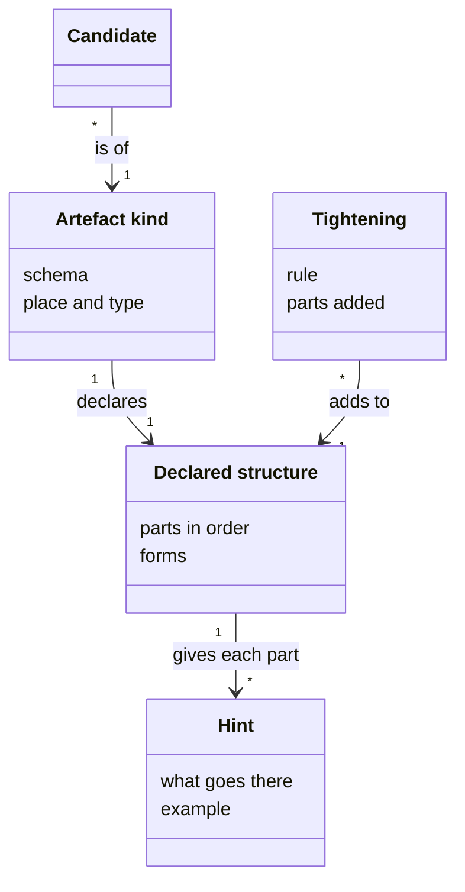
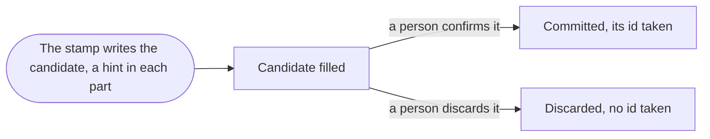

# VIEW-kinds-and-structures — Kinds and their structures

A part left out of an [artefact](../../core/glossary.md#term-artefact--artefact) reads the same as a part forgotten. A template that writers copy drifts from any other statement of its shape ([DEC-001](../../../../.pkit/capabilities/software-analysis/decisions/DEC-001-software-analysis-discipline.md)). So each [artefact kind](../glossary.md#term-artefact-kind--artefact-kind) declares its parts once, as data, in its [declared structure](../glossary.md#term-declared-structure--declared-structure), and the [stamp](../../core/glossary.md#term-stamp--stamp) writes each part holding its [hint](../glossary.md#term-hint--hint). A [project](../../core/glossary.md#term-project--project) reviews the shipped parts on a [candidate](../glossary.md#term-candidate--candidate) of its own, and adds parts of its own by a [tightening](../glossary.md#term-tightening--tightening).

## Artefact kind

Defined in [TERM-artefact-kind](../glossary.md#term-artefact-kind--artefact-kind).

**Why:** The [analysis](../glossary.md#term-analysis--analysis) keeps several kinds of product knowledge, such as who uses the [system](../../core/glossary.md#term-system--system) and what the words mean. Each kind's shape is declared once, as data, so a script can check every member against it ([DEC-001](../../../../.pkit/capabilities/software-analysis/decisions/DEC-001-software-analysis-discipline.md)).

An artefact kind is a category of what an analysis holds, such as its actors, its [use cases](../glossary.md#term-use-case--use-case) or its glossary terms. Every member of one kind has front matter of the same shape, which the kind's schema checks, and the same parts in its body. Each artefact kind lies in a [place](../../core/glossary.md#term-place--place) of its own, which gives its members one [artefact type](../../core/glossary.md#term-artefact-type--artefact-type).

**Attributes:**

- its schema, which checks a member's front matter whatever any [rule](../../core/glossary.md#term-rule--rule)'s status ([DEC-001 point 1](../../../../.pkit/capabilities/software-analysis/decisions/DEC-001-software-analysis-discipline.md#1-what-it-keeps-and-in-what-shape))
- its [declared structure](../glossary.md#term-declared-structure--declared-structure) (DEC-001 point 1)
- its place, and the type the place gives its members ([DEC-001 point 2](../../../../.pkit/capabilities/software-analysis/decisions/DEC-001-software-analysis-discipline.md#2-where-it-keeps-them))

**Relations:**

- It declares one declared structure (DEC-001 point 1).
- An analysis holds members of each kind (DEC-001 point 2).

**States:** None.

**Always true:**

- Every member carries every part its kind ships, and a part with nothing to say reads `None.` (DEC-001 point 1).
- A new kind needs a decision of its own, so no [project](../../core/glossary.md#term-project--project) adds one (DEC-001 points 1 and [11](../../../../.pkit/capabilities/software-analysis/decisions/DEC-001-software-analysis-discipline.md#11-scope-boundary-and-how-the-analysis-meets-the-solution)).

## Declared structure

Defined in [TERM-declared-structure](../glossary.md#term-declared-structure--declared-structure).

**Why:** A script checks only a structure it can read, and a template that writers copy drifts from any other statement of it. Declared once as data, the structure gives the check one home, and a template rendered from it cannot disagree with the check ([DEC-001](../../../../.pkit/capabilities/software-analysis/decisions/DEC-001-software-analysis-discipline.md)).

A declared structure lists, in order, the parts that each member of one [artefact kind](../glossary.md#term-artefact-kind--artefact-kind) carries in its body, or that each [revalidation record](../glossary.md#term-revalidation-record--revalidation-record) carries. Each part has a permanent id, a label and an example, and a [hint](../glossary.md#term-hint--hint) where a writer fills it. A part may take a form a script checks. The [stamp](../../core/glossary.md#term-stamp--stamp) writes each body from it, and the kind's template is the same rendering.

**Attributes:**

- its parts in their order, each with its id, its label, its example, and its hint where a writer fills it ([DEC-001 point 1](../../../../.pkit/capabilities/software-analysis/decisions/DEC-001-software-analysis-discipline.md#1-what-it-keeps-and-in-what-shape))
- the form of a part or of a front-matter field, such as one sentence for a goal (DEC-001 point 1)
- the ids of the parts its kind retired, which are never given again (DEC-001 point 1)

**Relations:**

- It belongs to one artefact kind, or to the revalidation record's kind (DEC-001 point 1).
- It gives each part a writer fills its hint (DEC-001 point 1).
- A [project](../../core/glossary.md#term-project--project)'s [tightenings](../glossary.md#term-tightening--tightening) add to it (DEC-001 point 1).

**States:** None.

**Always true:**

- An [artefact](../../core/glossary.md#term-artefact--artefact)'s body is held to it where the format [rule](../../core/glossary.md#term-rule--rule) binds, and a revalidation record's body is held to it always (DEC-001 point 1).
- Artefacts in force move to the current declared structure, and a revalidation record stays as it was written (DEC-001 point 1).

## Hint

Defined in [TERM-hint](../glossary.md#term-hint--hint).

**Why:** The first writer of an [artefact](../../core/glossary.md#term-artefact--artefact), often an agent, should meet what a part asks for rather than a bare label. So the hint stands where the content goes ([DEC-001](../../../../.pkit/capabilities/software-analysis/decisions/DEC-001-software-analysis-discipline.md)).

A hint is a marked comment on one line, `<!-- pkit:hint … -->`, which says what goes in a part or a field and gives an example. The [stamp](../../core/glossary.md#term-stamp--stamp) writes it as the placeholder of each part and each front-matter field a writer fills. The writer writes the content where the hint stood, and deletes the hint.

**Attributes:**

- what goes there, and an example ([DEC-001 point 1](../../../../.pkit/capabilities/software-analysis/decisions/DEC-001-software-analysis-discipline.md#1-what-it-keeps-and-in-what-shape))

**Relations:**

- It belongs to one part of a [declared structure](../glossary.md#term-declared-structure--declared-structure), or to one front-matter field a writer fills (DEC-001 point 1).

**States:** A hint stands in a new artefact until its writer fills the part or the field (DEC-001 point 1).

**Always true:**

- A hint left in is refused whatever any [rule](../../core/glossary.md#term-rule--rule)'s status, and the check's message repeats it (DEC-001 point 1).
- A hint binds nothing. What binds is a part's presence, its order and its form (DEC-001 point 1).

## Tightening

Defined in [TERM-tightening](../glossary.md#term-tightening--tightening).

**Why:** The shipped parts come from established practice, not from a [project](../../core/glossary.md#term-project--project)'s own software. What a project's review of them finds goes into its own changes to the structure. Those serve the project alone, so the project decides whether each binds ([DEC-001](../../../../.pkit/capabilities/software-analysis/decisions/DEC-001-software-analysis-discipline.md)).

A tightening is a group of a project's own changes to one [artefact kind](../glossary.md#term-artefact-kind--artefact-kind)'s [declared structure](../glossary.md#term-declared-structure--declared-structure), in the [capability](../../core/glossary.md#term-capability--capability)'s `project/structures.yaml`. It adds parts, makes a part required, or closes the kind's list of labels. It names the project's own [rule](../../core/glossary.md#term-rule--rule) that asks for it.

**Attributes:**

- the rule of the project's own that asks for it ([DEC-001 point 1](../../../../.pkit/capabilities/software-analysis/decisions/DEC-001-software-analysis-discipline.md#1-what-it-keeps-and-in-what-shape))
- each part it adds, placed after an element, with its [hint](../glossary.md#term-hint--hint) and its example (DEC-001 point 1)

**Relations:**

- It adds to one artefact kind's declared structure, never the [revalidation record](../glossary.md#term-revalidation-record--revalidation-record)'s (DEC-001 point 1).

**States:** A tightening binds nothing while its rule is proposed. It binds where its rule and the format rule both bind, once both are accepted (DEC-001 point 1).

**Always true:**

- It never drops, loosens or reorders a shipped part, and adds no form and no kind (DEC-001 point 1).
- A new label, hint or example for a shipped part is no tightening, and names no rule (DEC-001 point 1).

## Candidate

Defined in [TERM-candidate](../glossary.md#term-candidate--candidate).

**Why:** The shipped parts are a starting point a [project](../../core/glossary.md#term-project--project) reviews, never a default it skips, and only its own examples show whether they suit it. On a brownfield project, the code, the documents and the decisions are the ground truth, and a person confirms what is drawn from them ([DEC-001](../../../../.pkit/capabilities/software-analysis/decisions/DEC-001-software-analysis-discipline.md)).

A candidate is an [analysis](../glossary.md#term-analysis--analysis) [artefact](../../core/glossary.md#term-artefact--artefact) written as a draft, which is not committed until a person accepts it. A project fills one with a real case of its own, to judge its kind's parts. On a brownfield project, candidates are derived from what exists, and a person confirms each.

**Attributes:**

- its [artefact kind](../glossary.md#term-artefact-kind--artefact-kind), and what is filled in its parts ([DEC-001 point 1](../../../../.pkit/capabilities/software-analysis/decisions/DEC-001-software-analysis-discipline.md#1-what-it-keeps-and-in-what-shape))
- on a brownfield project, what it was drawn from: the code, a document or a decision ([DEC-001 point 9](../../../../.pkit/capabilities/software-analysis/decisions/DEC-001-software-analysis-discipline.md#9-brownfield-onboarding))

**Relations:**

- It is of one artefact kind (DEC-001 point 1).

**States:** A candidate is drafted and filled, then confirmed and committed, or discarded. Once committed, it is an artefact in force, and its id is taken for good (DEC-001 points 1, [3](../../../../.pkit/capabilities/software-analysis/decisions/DEC-001-software-analysis-discipline.md#3-identifiers) and 9).

**Always true:**

- A person confirms each candidate before it is committed (DEC-001 point 9).
- Where an accepted [decision record](../../core/glossary.md#term-decision-record--decision-record) decides behaviour the code lacks, a candidate describes that behaviour as the record decides. Each such step is a [shortfall](../glossary.md#term-shortfall--shortfall) (DEC-001 point 9).
