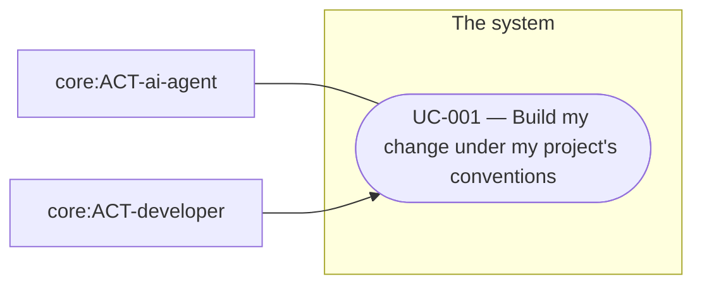

# Overview of the analysis of software-engineering

<!-- pkit:overview reads=4 fingerprint=sha256:2265cc3ec7b93ec13f5ee3d331b4850e34d02b18b6c787cf50a6b5a65be663e5 -->

No record states what software-engineering is for yet. Write one with `pkit new decision`, and name it as `purpose` in the entry of software-engineering under `analyses` in `.pkit/capabilities/software-analysis/project/config.yaml`.

This analysis covers software-engineering, and builds on the analysis of core.

## Use cases

- [UC-001 — Build my change under my project's conventions](../use-case-model/use-cases/UC-001-build-under-conventions.md)

## Reference

### Who takes part

| Actor | Who they are | Areas they act in |
| --- | --- | --- |
| core:ACT-ai-agent — AI agent | An actor of the analysis of core, which the head of the [glossary](../glossary.md) lists. | [the use cases](#use-cases) |
| core:ACT-developer — Developer | An actor of the analysis of core, which the head of the [glossary](../glossary.md) lists. | [the use cases](#use-cases) |

### Concepts

The [glossary](../glossary.md) defines each term.

### Use cases and their actors

---

The command `pkit analysis overview` writes this page from the analysis. Change the analysis, never this page (software-analysis DEC-003 point 8).
