# Overview of the analysis of visual-communication

<!-- pkit:overview reads=5 fingerprint=sha256:78d3dfc196dfb5cfb9ea0d55a27b689db6afb52026f555a1f39a5c1ec8ce19ec -->

No record states what visual-communication is for yet. Write one with `pkit new decision`, and name it as `purpose` in the entry of visual-communication under `analyses` in `.pkit/capabilities/software-analysis/project/config.yaml`.

This analysis describes what visual-communication does: who uses it, what they do with it, and what it must meet. It builds on the analysis of core.

## Areas

### 010-make

Make each piece, such as a deck or a figure in a documentation page, from library components and content of its own, so nothing made once is made again.

**Builds on:** no other area.

**Its requirements:** none.

**Its use cases:**

- [UC-093 — Build a presentation from library components](../use-case-model/use-cases/010-make/UC-093-build-presentation.md)
- [UC-094 — Put a figure in a documentation page](../use-case-model/use-cases/010-make/UC-094-put-figure-in-page.md)
- [UC-095 — Draw several views of one system from one model](../use-case-model/use-cases/010-make/UC-095-draw-views-of-system.md)
- [UC-096 — Add a new kind of visual to a piece as data](../use-case-model/use-cases/010-make/UC-096-add-visual-as-data.md)
- [UC-097 — Put a picture that a program makes in a piece](../use-case-model/use-cases/010-make/UC-097-put-produced-picture.md)

### 020-draw-and-hand-out

Draw a piece in each brand, mode, language and renderer it needs, hand it out as files, and take back what people change where it is drawn.

**Builds on:** [010-make](#010-make).

**Its requirements:** none.

**Its use cases:**

- [UC-098 — Give a piece another brand or another mode](../use-case-model/use-cases/020-draw-and-hand-out/UC-098-switch-brand-or-mode.md)
- [UC-099 — Draw a piece through another renderer](../use-case-model/use-cases/020-draw-and-hand-out/UC-099-draw-through-renderer.md)
- [UC-100 — Take back what people changed where a piece is drawn](../use-case-model/use-cases/020-draw-and-hand-out/UC-100-take-back-edits.md)
- [UC-101 — Give a piece in a second language](../use-case-model/use-cases/020-draw-and-hand-out/UC-101-give-second-language.md)
- [UC-102 — Hand out a piece as a PDF for each language](../use-case-model/use-cases/020-draw-and-hand-out/UC-102-hand-out-pdf.md)

### 030-build-libraries

Build the libraries pieces are made from, so pieces share one look and take each improvement only on purpose.

**Builds on:** [010-make](#010-make).

**Its requirements:** none.

**Its use cases:**

- [UC-103 — Improve a library component without breaking a piece](../use-case-model/use-cases/030-build-libraries/UC-103-improve-library-component.md)
- [UC-104 — Add a kind of piece the capability does not ship](../use-case-model/use-cases/030-build-libraries/UC-104-add-kind-of-piece.md)
- [UC-105 — Make a brand with modes on the axes it needs](../use-case-model/use-cases/030-build-libraries/UC-105-make-brand.md)
- [UC-106 — Build a brand on another brand](../use-case-model/use-cases/030-build-libraries/UC-106-build-brand-on-brand.md)
- [UC-107 — Use a brand's values in code](../use-case-model/use-cases/030-build-libraries/UC-107-use-brand-in-code.md)

### 040-draw-for-capabilities

Draw what another capability shows in the look of the project's libraries, with what they do not cover drawn the capability's own way.

**Its requirements:** none.

**Its use cases:**

- [UC-108 — Have another capability's diagrams drawn in my libraries' look](../use-case-model/use-cases/040-draw-for-capabilities/UC-108-draw-capability-visuals.md)

## Reference

### Who takes part

| Actor | Who they are | Areas they act in |
| --- | --- | --- |
| core:ACT-adopter — Adopter | An actor of the analysis of core, which the head of the [glossary](../glossary.md) lists. | [040-draw-for-capabilities](#040-draw-for-capabilities) |
| core:ACT-ai-agent — AI agent | An actor of the analysis of core, which the head of the [glossary](../glossary.md) lists. | [010-make](#010-make), [020-draw-and-hand-out](#020-draw-and-hand-out), [030-build-libraries](#030-build-libraries) |
| core:ACT-developer — Developer | An actor of the analysis of core, which the head of the [glossary](../glossary.md) lists. | [010-make](#010-make), [020-draw-and-hand-out](#020-draw-and-hand-out), [030-build-libraries](#030-build-libraries), [040-draw-for-capabilities](#040-draw-for-capabilities) |
| core:ACT-operator — Operator | An actor of the analysis of core, which the head of the [glossary](../glossary.md) lists. | [020-draw-and-hand-out](#020-draw-and-hand-out) |

### Concepts

The [glossary](../glossary.md) defines each term.

### Journeys

#### [JRN-010 — Give a talk in two languages and hand out its slides](../use-case-model/journeys/JRN-010-give-talk.md)

```mermaid
flowchart LR
  accTitle: JRN-010 — Give a talk in two languages and hand out its slides
  accDescr: The flow of JRN-010: core:ACT-developer takes 5 steps in order, UC-093, UC-101, UC-099, UC-100, UC-102.
  core_ACT_developer["core:ACT-developer"]
  step_1(["1. UC-093 — Build a presentation from library components"])
  step_2(["2. UC-101 — Give a piece in a second language"])
  step_3(["3. UC-099 — Draw a piece through another renderer"])
  step_4(["4. UC-100 — Take back what people changed where a piece is drawn"])
  step_5(["5. UC-102 — Hand out a piece as a PDF for each language"])
  core_ACT_developer --> step_1
  step_1 --> step_2
  step_2 --> step_3
  step_3 --> step_4
  step_4 --> step_5
```

### Diagrams

`pkit analysis diagram --analysis visual-communication` prints this analysis's diagrams from the working tree. Its subjects are `use-cases`, `journeys`, `requirements` and `chain`, or a journey's or a requirement's id.

---

The command `pkit analysis overview` writes this page from the analysis. Change the analysis, never this page (software-analysis DEC-003 point 8).
